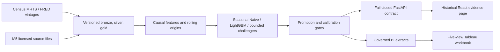

# RetailPRED v2

RetailPRED is an evidence-first forecasting portfolio rebuilt from an undergraduate project. The v2 work replaces pseudo-replicated weekly targets and leaky rolling features with native-frequency data contracts, causal features, rolling-origin evaluation, governed model promotion, hierarchical M5 forecasting, a fail-closed API, and Tableau-ready reporting.

> **Publication status:** Milestones 0–5 are complete for the local, reproducible scope. The governed API and web demo expose historical evaluation evidence only; no live production inference, cloud Databricks run, remote MLflow run, or public Tableau workbook is claimed. See the [publication audit](docs/v2/PUBLICATION_AUDIT.md) and [current status](docs/v2/STATUS.md).

[](https://www.python.org)
[](https://nodejs.org)
[](LICENSE)

## Recruiter skim

Two related use cases share one governed platform:

| Use case | Data and grain | Selected point model | Measured decision |
|---|---|---|---|
| Macro planning | Census MRTS, 11 monthly U.S. retail series | Global LightGBM challenger | Mean category WAPE 4.49% versus 6.35% for Seasonal Naive on 5,324 revised-history folds; not promoted without point-in-time vintage validation |
| Operational demand | M5, 30,490 item/store daily series and 42,840 hierarchy nodes | Global LightGBM champion | WRMSSE 0.813301 versus 0.869701 for Seasonal Naive, a 6.48% improvement; won all five rolling windows |

The more complex model did not automatically win. NHITS failed its bounded M5 feasibility gate; zero-shot Chronos-2 advanced from a 600-series subset, then failed the complete hierarchy benchmark with 1.937468 WRMSSE and severe aggregate underforecasting. A reconciliation challenger scored 0.768502 on the main holdout but failed the all-window stability gate. M5 conformal intervals reached 80.38% weighted coverage overall but only 69.38% for high-volume bottom series, so uncertainty remains unavailable for serving.

### Read it as a data-science project

- [Leakage diagnosis and before/after evidence](docs/v2/LEAKAGE_REPORT.md)
- [MRTS LightGBM benchmark](docs/v2/M3_LIGHTGBM.md) and [regime analysis](docs/v2/M3_MRTS_REGIMES.md)
- [M5 baseline](docs/v2/M4_M5_BASELINE.md), [LightGBM result](docs/v2/M4_M5_LIGHTGBM.md), and [rolling stability](docs/v2/M4_M5_STABILITY.md)
- [NHITS](docs/v2/M4_M5_NHITS_FEASIBILITY.md), [Chronos-2](docs/v2/M4_M5_CHRONOS2.md), [reconciliation](docs/v2/M4_M5_RECONCILIATION_STABILITY.md), and [probabilistic](docs/v2/M4_M5_PROBABILISTIC.md) decision gates

### Read it as an ML/data-platform project

- [Versioned bronze/silver/gold architecture](docs/architecture/data_platform.md)
- [Model protocol](forecasting/models/base.py), [promotion rules](forecasting/promotion.py), and [frozen portfolio](forecasting/portfolio.py)
- [Databricks/dbt execution boundary](docs/architecture/data_platform.md)
- [Fail-closed serving contract](docs/v2/M5_SERVING_CONTRACT.md)
- [Governed BI extracts and Tableau workbook](bi/README.md)

## What is implemented

- Immutable contracts for series, observations, releases, forecasts, actuals, model decisions, and BI extracts.
- Census MRTS and FRED/ALFRED ingestion with observation time, vintage time, explicit as-of selection, and no synthetic fallback.
- Causal monthly features: target-derived lags, rolling statistics, differences, and changes are shifted before aggregation.
- Comparable rolling-origin folds with WAPE, MAE, RMSSE, bias, pinball loss, weighted interval score, coverage, and interval width.
- The official sparse 12-level M5 hierarchy, revenue weights, WRMSSE, bottom-up aggregation, and nonnegative diagonal-variance WLS reconciliation.
- Seasonal Naive, global LightGBM, NHITS feasibility, and Chronos-2 feasibility/full-hierarchy gates; retired v1 labels are excluded from v2 selection.
- Local MLflow tracking proof with data hash, Git revision, parameters, metrics, runtime metadata, and artifacts. A durable remote run is still pending credentials.
- Databricks Asset Bundle and dbt project with 6 models, 20 data tests, and 4 sources. These are parsed and contract-tested locally, not claimed as a cloud deployment.
- FastAPI `/api/v2` routes that return typed unavailable states for unapproved production, stale-data, incompatible-model, and uncalibrated-uncertainty requests.
- A React evidence page backed by a deterministic 2016 M5 fixture. It is explicitly historical and is not a current forecast.
- Five governed Tableau views backed by an aggregate-only Hyper extract and checked against the same frozen model decisions.
- A complete live-loop foundation ([snapshot contract](docs/v2/SNAPSHOT_CONTRACT.md), [execution evidence ledger](docs/v2/DATABRICKS_RUN.md)): ALFRED vintage pulls behind a fail-closed series mapping, the predeclared point-in-time promotion gate ([M3_VINTAGE_BACKTEST.md](docs/v2/M3_VINTAGE_BACKTEST.md)), a four-task scheduled Databricks pipeline (ingest → fail-closed scoring → realized errors → snapshot publish to the machine-written `live-data` branch), GitHub Pages delivery with pre-deploy contract validation, vintage-safe seasonal-naive benchmarks frozen beside every forecast, and immutable first-release-plus-revised realized tracking. Implemented and locally verified; no workspace run, vintage pull, or snapshot publish has executed yet, and claims upgrade only as `DATABRICKS_RUN.md` records them.

## System boundary



The macro MRTS and operational M5 tasks remain separate: national monthly dollar sales are not presented as store/SKU demand, and M5 calendar, price, SNAP, and hierarchy fields are not invented for MRTS.

## Run and verify

Prerequisites: Python 3.11, Node.js 24 LTS, and Git.

```bash
git clone https://github.com/oleeveeuh/retailPRED.git
cd retailPRED
make setup
make verify
```

The verification gate runs the Python suite plus frontend type-check, lint, and production build. The latest local checkpoint is 143 Python tests with no skips; CI must reproduce the result on the publication commit.

Run the restricted v2 API and frontend:

```bash
# terminal 1
.venv-v2/bin/python -m uvicorn backend.main:app --port 8000

# terminal 2
cd frontend
npm run dev
```

Useful endpoints:

- `GET /api/v2/health` separates service health, model availability, and data freshness.
- `GET /api/v2/models` returns frozen portfolio decisions rather than scanning legacy pickle files.
- `GET /api/v2/demo-catalog` lists the deterministic historical fixture.
- `POST /api/v2/forecasts` serves only the documented fixture; production mode fails closed.

Legacy v1 mutation, mock, training, export, and scenario routes are absent by default. They can be enabled only for archival investigation with `RETAILPRED_ENABLE_LEGACY_API=true`; they are not part of the v2 product claim.

## Reproduce the measured work

MRTS benchmark commands require the named Census annual-revision workbook and an explicit vintage timestamp:

```bash
make baseline-mrts WORKBOOK=/path/to/benchsales26.xlsx VINTAGE_TIME=2026-11-02T00:00:00+00:00
make benchmark-mrts WORKBOOK=/path/to/benchsales26.xlsx VINTAGE_TIME=2026-11-02T00:00:00+00:00
make probabilistic-mrts WORKBOOK=/path/to/benchsales26.xlsx VINTAGE_TIME=2026-11-02T00:00:00+00:00
```

M5 commands require the four competition files under `data/v2/source/m5/`. They are intentionally not redistributed; expected files, checksums, and validation steps are in [the M5 source record](docs/v2/M4_M5_SOURCE.md).

```bash
make validate-m5
make baseline-m5
make rolling-m5
make rolling-reconcile-m5
make probabilistic-m5
```

The Tableau workbook and extracts are reproducible from tracked aggregate result reports:

```bash
make bi-extracts AS_OF_DATE=2026-11-03
make setup-tableau
make tableau-workbook
```

## Repository map

```text
forecasting/          v2 contracts, causal features, models, evaluation, hierarchy
retailpred/platform/  versioned local data-platform reference implementation
databricks/           Delta bootstrap and Asset Bundle resources
warehouse/            dbt staging, marts, reporting models, and tests
backend/              restricted FastAPI v2 surface plus isolated legacy code
frontend/             publication-safe historical evidence page
bi/                   governed extracts, manifest, Hyper file, and Tableau workbook
scripts/              reproducible benchmark and artifact entry points
tests/                temporal, platform, model, serving, BI, and parity tests
docs/v2/              decisions, results, limitations, and implementation status
project_root/         preserved undergraduate pipeline; never a v2 input
```

## Limits and blocked claims

- MRTS evaluation uses a 2026 revised history, not the value actually available at every historical origin. LightGBM therefore remains a development challenger despite the measured gain.
- M5 ends in 2016. Its champion is valid for the published historical benchmark, not current retail behavior or a live business.
- No uncertainty method passed every promotion gate; the API and UI do not show invented confidence bands.
- Databricks and dbt code is locally tested and parsed, but no remote workspace execution is claimed.
- MLflow was proven against a local SQLite tracking store, not a durable shared server.
- The Tableau workbook was opened and checked locally; it has not been published to Tableau Public.
- The hosted frontend is static. There is no deployed v2 backend, automated retraining, drift monitor, rollback exercise, or production SLA.
- The live-loop foundation is implemented and locally verified but unexecuted externally: until the vintage gate promotes the MRTS champion and a scheduled job publishes snapshots, the frontend intentionally shows only the historical fixture, and the snapshot's `is_live` flag stays false.

## Deploying the showcase

- **GitHub Pages (target architecture):** merge `main`, then the `pages-deploy` workflow builds the frontend from `main`, validates `v2-latest.json` from the machine-written `live-data` branch against the snapshot contract, and deploys to `https://oleeveeuh.github.io/retailPRED/`. Snapshot updates on `live-data` trigger a redeploy automatically. Requires enabling GitHub Pages with the GitHub Actions source.
- **Local:** `cd frontend && npm run dev` (the snapshot panel stays hidden unless `VITE_LATEST_SNAPSHOT_URL` points at a reachable snapshot).
- **Container:** `docker compose up --build` serves the API and an nginx-hosted frontend.
- Secondary v1 UI and model code remains in Git history for provenance. It contains simulations and must not be described as v2 functionality.
- Forty-two legacy pickle files total about 402 MB in the working tree and materially bloat clone size. Removing them safely requires a planned history rewrite; see the publication audit.

## Data, artifacts, and licensing

- Tracked v2 assets are contracts, tests, checksums, aggregate reports, the aggregate-only Hyper extract, and the deterministic historical demo fixture.
- Raw downloads, canonical tables, fold-level predictions, trained v2 weights, databases, logs, and secrets are ignored.
- M5 source files are user-supplied and are not redistributed. Users are responsible for the competition/data terms that apply to their access.
- FRED is a distribution platform for series from many providers; each series retains its own source and usage terms. This repository does not assert that every FRED series is public domain.
- The MIT license covers repository code. It does not relicense upstream datasets or third-party model artifacts.

An earlier commit exposed a local `.env`; the credentials were rotated and the path was removed from reachable history. Report any residual secret privately before opening a public issue.

## Historical v1 snapshot

The undergraduate implementation is retained for comparison on the `v1-undergrad` tag and in archived directories. Its expanded weekly/daily rows, inclusive rolling features, randomized fallbacks, and heuristic outputs are not valid v2 evidence. The detailed diagnosis is preserved in [the original audit](docs/v2/AUDIT.md); the default API and publication frontend exclude those paths.

## The v1 → v2 story: why the platform changed

**v1 (GCP + Airflow).** The original system ran an Airflow-scheduled pipeline on cloud infrastructure: monthly Census values were expanded into synthetic weekly rows, features were computed with inclusive rolling windows (the target month's value leaked into its own features), per-category model pickles served through a SQLite-backed FastAPI, and a React dashboard on Vercel presented the results. The orchestration itself worked — jobs ran on schedule, data flowed, the site rendered. That is worth saying plainly, because it sharpens the diagnosis: **v1's failures were not operational. They were epistemic.** The validation snapshot showed 9.76% MAPE for LightGBM against 14.11% for seasonal naive, but the 429 "validation rows" were monthly actuals repeated across weekly targets — pseudo-replication that flattered every model — and the neural entries (PatchTST, TimesNet) were heuristic outputs from a retired pipeline. The published demo claimed 90.2% accuracy and 0.26% MAPE from static data that no deployed model had produced. The infrastructure delivered numbers; nothing in the stack could say what those numbers meant.

**The rebuild decision.** The v2 diagnosis kept one thing from v1's architecture and rejected the rest: orchestration was never the problem, so the question became *what the pipeline should enforce, not just schedule*. Three requirements drove the platform choice:

1. **Revisions had to be first-class.** Census data changes after publication, so the storage layer needed immutable bronze rows keyed by vintage, versioned silver, and point-in-time selection — semantics that a relational warehouse only provides by hand-building slowly-changing tables, but that Delta Lake implements natively through append-only tables and time travel.
2. **Governance had to be auditable** — declared schemas, quality gates that fail closed, and an execution ledger. Unity Catalog plus declared Delta table properties give that without a separate audit stack.
3. **The deployment had to be the repository** — one bundle definition in CI, no cloud-console drift, zero-cost serverless for a pipeline that runs once a month.

That is why v2 runs on Databricks: the lakehouse *is* the revision-awareness design rather than a hand-built layer over it, and the governance lives next to the compute. Airflow remains a perfectly good orchestrator — and the honest tradeoff is real: v2 accepts platform lock-in in exchange for native versioning, and it deliberately drops the always-on serving posture v1 had, because the measurement work showed no MRTS model had earned live inference.

**What the rebuild proved.** The same 11 categories, re-measured properly: LightGBM beats seasonal naive by 29% on revised history (4.49% vs 6.35% WAPE) — and then loses in real time on ALFRED vintages (8.49% vs 8.16%), where a promotion gate written before the measurement refused it. M5's global LightGBM was promoted (WRMSSE 0.8133 vs 0.8697) while four other approaches — Chronos-2, NHITS, MinT-style reconciliation, conformal intervals — were rejected by their own predeclared gates. v1 could not have produced any of those sentences, because nothing in it could fail.

## License

Repository code is available under the [MIT License](LICENSE).
