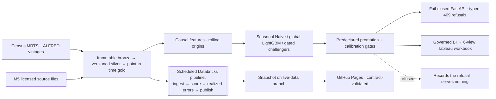
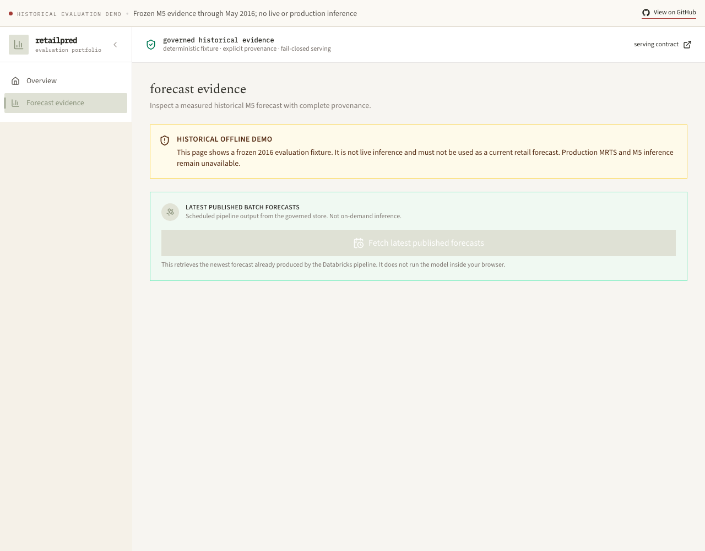
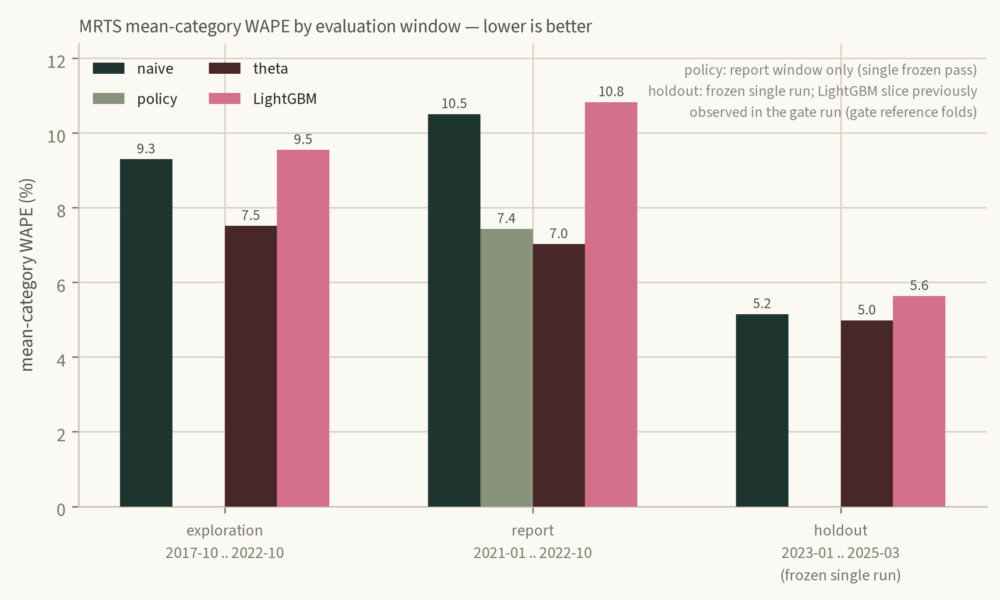
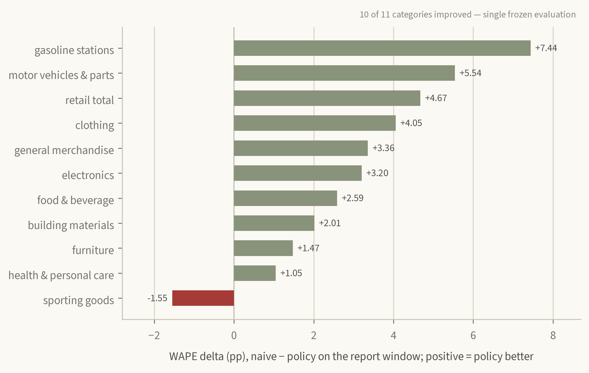
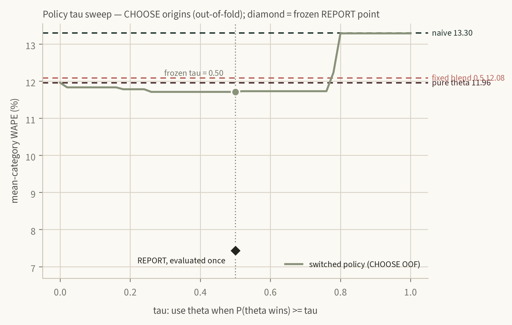
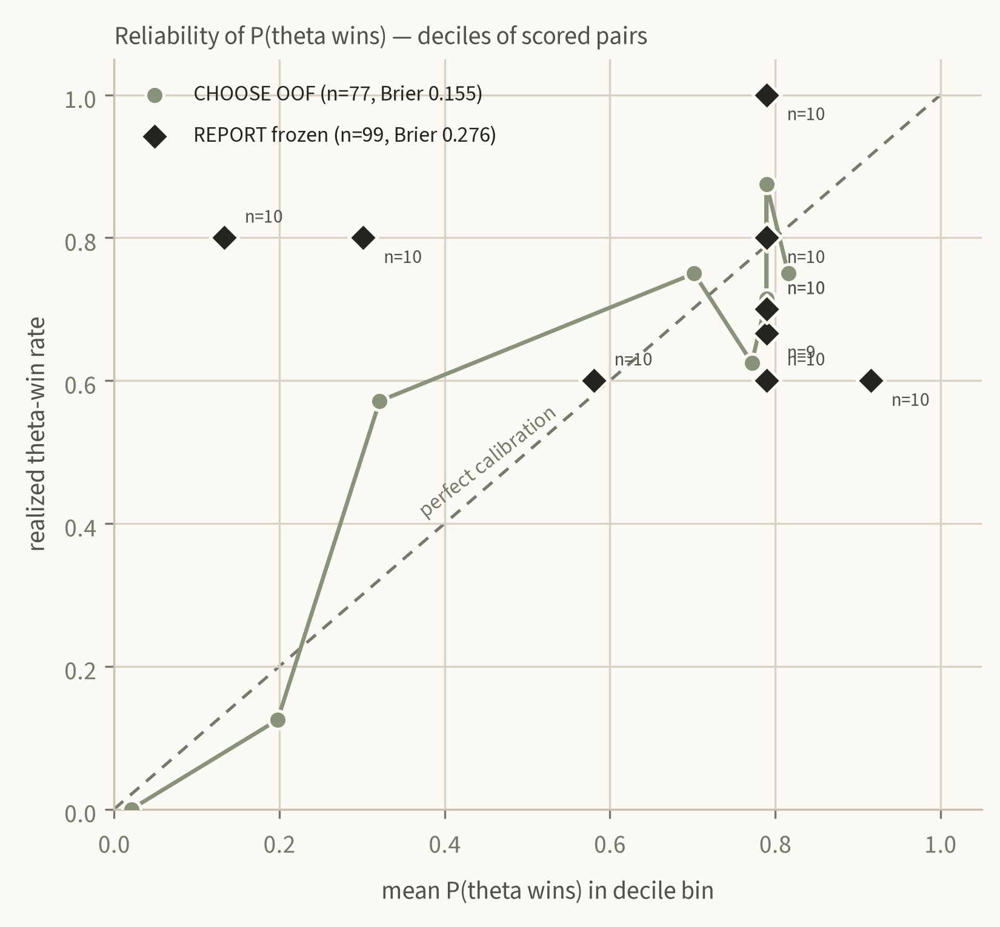

# retailpred — field notes

**An evidence-first forecasting platform** rebuilt from an undergraduate project. Every number below is measured, every model decision went through a predeclared gate, and the serving contract stays dark until a model earns the right to forecast.

[](https://github.com/oleeveeuh/retailPRED/actions/workflows/ci-cd.yml)
[](https://oleeveeuh.github.io/retailPRED/)
[](https://github.com/oleeveeuh/retailPRED/releases/tag/v2.0.0)
[](LICENSE)

**Live showcase → [oleeveeuh.github.io/retailPRED](https://oleeveeuh.github.io/retailPRED/)** · Portfolio → [oleeveeuh.github.io](https://oleeveeuh.github.io/)

## The scoreboard

| The question | The measured answer | Verdict | Evidence |
|---|---|---|---|
| Can one model forecast 30,490 Walmart item/store series better than naive, across an official 42,840-node hierarchy? | **WRMSSE 0.8133 vs 0.8697** (+6.48%), won all 5 rolling stability windows | ✅ **Promoted** — serves as the site's offline demo | [M4 benchmark](docs/v2/M4_M5_LIGHTGBM.md) · [stability](docs/v2/M4_M5_STABILITY.md) |
| Can global LightGBM beat naive forecasting 11 Census retail categories on revised history? | Mean category **WAPE 4.49% vs 6.35%** (+29%), all 11 categories improved, 5,324 folds | ✅ On revised history only | [M3 benchmark](docs/v2/M3_LIGHTGBM.md) |
| Then the harder question: what could it know at *forecast time*? | On 106 real ALFRED vintages: **8.49% vs 8.16%** — the edge disappears | ❌ **Gate refused the model** | [Vintage gate](docs/v2/M3_VINTAGE_BACKTEST.md) |
| Does the pipeline actually run — end to end, on real infrastructure? | **Executed on Databricks**: 13 Delta tables, dbt 20/20 green on populated tables, live Census pull merged (2,200 rows, cutoff Aug 2026) | ✅ [Execution ledger](docs/v2/DATABRICKS_RUN.md) | — |

**The failed gate is the headline, not a footnote.** A promotion gate written *before* measurement refused the model its author wanted to promote — and the system stayed honestly dark. Four other approaches were rejected by their own predeclared gates: zero-shot Chronos-2 (1.937 WRMSSE on the full hierarchy), NHITS, MinT-style reconciliation, and conformal intervals (69.38% coverage on high-volume series). [The gate document →](docs/v2/M3_VINTAGE_BACKTEST.md) · [The full research story, chapter by chapter →](https://oleeveeuh.github.io/retailPRED/#/story)

## Two datasets, two lessons

| | **Census MRTS** — macro planning | **M5 (Kaggle)** — operational demand |
|---|---|---|
| Grain | 11 national monthly categories, millions of dollars | 30,490 item/store daily series |
| The catch | **Alive**: every month is published, then revised | **Frozen**: fixed snapshot, ends May 2016 |
| What it taught | Real-time forecasting is measurably harder than revised history — and the revision process itself is the next modeling frontier | Related-series pooling beats per-series models at scale; the hierarchy must add up exactly |

The tracks stay separate on purpose: national dollar categories are never presented as store/SKU demand.

## How it works



Delivery target: **[oleeveeuh.github.io/retailPRED](https://oleeveeuh.github.io/retailPRED/)** — the Pages workflow validates the snapshot contract before anything deploys, and the UI reports a missing snapshot as unavailable instead of inventing one.

## What is implemented

**The showcase, live** — every card below is rendered from governed evidence, and the screenshot is the real deployment:

<p align="center">
  
</p>

**The story behind the scoreboard** — the gate refusal kicked off a full investigation, told chapter by chapter in [the research story](#the-research-story) below (or on the [live story page](https://oleeveeuh.github.io/retailPRED/#/story)): where the failure lived, the hypothesis graveyard, theta, the spent holdout, and the regime switch that lost to pure theta — every number from a frozen artifact, with themed research figures placed where they belong in the narrative.

### A governed data platform — revisions are first-class

The storage layer never overwrites history: bronze is append-only, silver is keyed by vintage, and gold is selected *as of* any moment. The entire point-in-time guarantee is three lines:

```python
eligible = clean.loc[clean["vintage_time"] <= pd.Timestamp(as_of)]
latest = eligible.groupby(["series_id", "observation_time"])["vintage_time"].idxmax()
return eligible.loc[latest]   # exactly what a forecaster could have known
```

On top of it: Census MRTS and FRED/ALFRED ingestion that fails closed (no synthetic fallback), causal monthly features shifted before aggregation, the official sparse 12-level M5 hierarchy with WRMSSE, and Databricks Delta + dbt models generated from the same declared specifications — 20 data tests green against live tables.

### Model selection by predeclared gate

The gate criteria were written before the measurement and are enforced in code — the failed real-time verdict exists because this function said no:

```python
gate["passed"] = (
    gate["mean_category_wape_improved"]
    and gate["improved_series_count"] >= gate["series_count"] - 1
    and gate["acceptable_regressions"]
)
```

Around it: comparable rolling-origin folds (WAPE, MAE, RMSSE, bias, pinball loss, WIS, coverage), MLflow tracking with full provenance, a frozen portfolio decisions module that serving reads instead of "whatever trained last," and four documented rejections — Chronos-2, NHITS, MinT-style reconciliation, conformal intervals.

### A serving contract that stays dark until earned

Production requests are never approximated with a demo — they return a typed refusal with the exact action required:

```json
{"detail": {"code": "production_model_unavailable",
            "message": "The frozen portfolio does not authorize production inference.",
            "required_action": "offline_demo_until_refit_on_current_data",
            "model_status": "development_challenger"}}
```

The React evidence page consumes the same contract, labels the fixture as historical, and hides calibrated uncertainty behind its (failed) promotion gate:

<p align="center">
  
</p>

### A live loop, executed on Databricks

Four scheduled serverless tasks — with the scoring task refusing while the portfolio has not authorized a champion:

```yaml
tasks:
  - pull_latest_census_release     # live Census -> versioned silver
  - score_promoted_model           # refuses until the gate passes
  - evaluate_realized_errors       # forecasts vs revised actuals
  - publish_snapshot_github        # contract-validated JSON -> live-data branch
```

Plus ALFRED vintage pulls behind a fail-closed series mapping, vintage-safe seasonal-naive benchmarks frozen beside every forecast, and the full execution ledger in [DATABRICKS_RUN.md](docs/v2/DATABRICKS_RUN.md).

## Two datasets, two lessons

| | **Census MRTS** — macro planning | **M5 (Kaggle)** — operational demand |
|---|---|---|
| Grain | 11 national monthly categories, millions of dollars | 30,490 item/store daily series |
| The catch | **Alive**: every month is published, then revised | **Frozen**: fixed snapshot, ends May 2016 |
| What it taught | Real-time forecasting is measurably harder than revised history — and the revision process itself is the next modeling frontier | Related-series pooling beats per-series models at scale; the hierarchy must add up exactly |

The tracks stay separate on purpose: national dollar categories are never presented as store/SKU demand.

## How it works


Delivery target: **[oleeveeuh.github.io/retailPRED](https://oleeveeuh.github.io/retailPRED/)** — the Pages workflow validates the snapshot contract before anything deploys, and the UI reports a missing snapshot as unavailable instead of inventing one.

## What is implemented

- **Immutable contracts** for series, observations, releases, forecasts, actuals, model decisions, and BI extracts — with observation time, vintage time, explicit as-of selection, and no synthetic fallback.
- **Causal monthly features** — target-derived lags, rolling statistics, and changes shifted before aggregation — plus comparable rolling-origin folds with WAPE, MAE, RMSSE, bias, pinball loss, WIS, and coverage.
- **The official sparse 12-level M5 hierarchy**: revenue weights, WRMSSE, exact bottom-up aggregation, and nonnegative diagonal-variance WLS reconciliation.
- **Governed model selection**: Seasonal Naive and global LightGBM measured; NHITS, Chronos-2, reconciliation, and conformal intervals each rejected by their own gates. Retired v1 labels are excluded from v2 selection.
- **A live-loop foundation, executed on Databricks**: ALFRED vintage pulls behind a fail-closed series mapping, a four-task scheduled pipeline (ingest → fail-closed scoring → realized errors → snapshot publish), vintage-safe seasonal-naive benchmarks frozen beside every forecast, immutable first-release-plus-revised realized tracking, and a [versioned snapshot contract](docs/v2/SNAPSHOT_CONTRACT.md). Scoring stays refused until the [vintage gate](docs/v2/M3_VINTAGE_BACKTEST.md) promotes a champion — by design.
- **A fail-closed FastAPI `/api/v2`** returning typed unavailable states for unapproved production, stale-data, incompatible-model, and uncalibrated-uncertainty requests.
- **Five governed Tableau views** backed by an aggregate-only Hyper extract, checked against the same frozen model decisions.
- **A React evidence page** (this deployment) backed by a deterministic 2016 M5 fixture — explicitly historical, never a current forecast.
- **MLflow tracking proof** locally with data hash, Git revision, parameters, metrics, and artifacts.

## Run and verify

Prerequisites: Python 3.11, Node.js 24 LTS, Git.

```bash
git clone https://github.com/oleeveeuh/retailPRED.git && cd retailPRED
make setup          # Python 3.11 venv + frontend dependencies
make verify         # publication gate → 220 Python tests → frontend type-check, lint, build
```

Run the restricted API and frontend locally:

```bash
.venv-v2/bin/python -m uvicorn backend.main:app --port 8000   # terminal 1
cd frontend && npm run dev                                     # terminal 2
```

`GET /api/v2/health` separates service health from model availability and data freshness; `GET /api/v2/models` returns frozen decisions; `POST /api/v2/forecasts` serves only the documented fixture — production mode fails closed with a typed 409.

## Reproduce the measurements

Census benchmarks require the named annual-revision workbook and an explicit vintage timestamp:

```bash
make benchmark-mrts WORKBOOK=/path/to/benchsales26.xlsx VINTAGE_TIME=2026-11-02T00:00:00+00:00
make probabilistic-mrts WORKBOOK=/path/to/benchsales26.xlsx VINTAGE_TIME=2026-11-02T00:00:00+00:00
```

M5 requires the four competition files under `data/v2/source/m5/` (user-supplied, not redistributed — checksums and validation in [the source record](docs/v2/M4_M5_SOURCE.md)):

```bash
make validate-m5 && make baseline-m5 && make rolling-m5 && make rolling-reconcile-m5 && make probabilistic-m5
```

Real-time vintage evaluation requires a FRED key and the completed series mapping (`config/fred_mrts_mapping.json`):

```bash
make fetch-alfred-mrts END_YEAR=2026 FRED_API_KEY=$FRED_API_KEY   # ~15 min, 106 vintages × 11 series
make vintage-backtest-mrts
```

The Tableau workbook rebuilds from tracked aggregate reports: `make bi-extracts AS_OF_DATE=2026-11-03 && make setup-tableau && make tableau-workbook`.

## Repository map

```text
forecasting/          contracts, causal features, models, evaluation, hierarchy, benchmarks
retailpred/           platform (Delta binding, snapshot contract) + live loop (ingest, scoring, realized)
databricks/           serverless jobs and Asset Bundle resources; warehouse/ holds the dbt project
backend/              restricted FastAPI v2 surface; legacy v1 code isolated behind a flag
frontend/             showcase landing + governed evidence page (GitHub Pages)
bi/                   governed extracts, manifest, Hyper file, Tableau workbook
scripts/              reproducible benchmark, ingestion, and publication-gate entry points
tests/                temporal, platform, model, serving, BI, and parity tests
docs/v2/              decisions, measured results, limitations, execution ledger
project_root/         preserved undergraduate pipeline; never a v2 input
```

## Limits — stated, not hidden

- MRTS benchmark numbers use a 2026 revised history, not origin-available values. LightGBM remains a **development challenger**: the real-time gate refused it.
- M5 ends in 2016 — its champion is valid for that benchmark, not current retail behavior.
- No uncertainty method passed its gate; nothing on this site shows invented confidence bands.
- dbt and Databricks code is executed on a Free Edition workspace; no paid-tier features, remote MLflow server, or production SLA is claimed.
- The live snapshot chain activates only after the vintage gate promotes a champion and the schedule runs; until then the site serves the historical fixture and labels it as such.

## The research story

The eight-chapter field-notes version of what happened after the gate said no — the same story the [live story page](https://oleeveeuh.github.io/retailPRED/#/story) tells, with figures generated by the satellite's themed figure scripts. Every number below comes from a frozen artifact.

### 01 — the gate that said no

*On revised history the champion looked unbeatable; the one test that mattered disagreed.*

On revised history, the global LightGBM looked genuinely good: 4.49% mean-category WAPE against the seasonal naive's 6.35%, better in all 11 Census retail categories. That result earned it a shot at the real thing. The vintage gate had been written before the measurement, in the style I want to keep: fix the criteria first, then let the data answer.

The gate rebuilt every training set from 106 real ALFRED vintages — only what was publishable at each forecast origin — and scored 1,408 folds. Real time flipped the result: 8.49% vs the naive's 8.16%, with LightGBM improving just 4 of 11 categories. It failed on all three predeclared criteria, and the serving decision stayed fail-closed. No champion, no hand-waving — the pipeline kept serving nothing, which is what an honest gate is for. ([vintage gate document](docs/v2/M3_VINTAGE_BACKTEST.md))

### 02 — where the failure lives

*Before rebuilding anything, find out exactly where the edge died.*

First, reproduction: the satellite re-ran the failed gate with pinned versions and got the naive back to the digit — max diff 0.0. Nothing was wrong with the platform. The failure belonged to the model.

The decomposition that followed changed how I read every metric in this project. Pooled across folds (volume-weighted), the LightGBM actually beat naive even in real time — 5.87% vs 6.54% on exploration origins. The gate metric weights categories equally, and the model lost exactly there: it won big, quiet categories and lost small, volatile ones. By horizon, it won h=1 and lost h=12 badly — the recursive rollout feeds its own drift back eleven times, and clothing degrades monotonically from +0.6pp to −8.5pp. By regime, every point of advantage came from the pandemic disruption. And the category regressions ranked by revision magnitude (Spearman −0.755): loudly-revised categories were where it bled. Training staleness, the first suspect, measured constant and was ruled out. ([satellite forensics](https://github.com/oleeveeuh/retailPRED-satellite/blob/main/FINDINGS.md))

### 03 — the hypothesis graveyard

*Four predeclared hypotheses. Four refutations — and one load-bearing accident.*

H1: drop the preliminary training rows, the values most likely to be revised later. Refuted — trimming never helped (−0.41pp on the report window). The poison, if any, was not in the fit-row targets. H2: give the model revision metadata — counts, magnitudes, value ages. Refuted (−0.68pp); an L1 tree ensemble could not turn reliability notes into sharper targets.

H4: change the target transformation. Every alternative lost: year-over-year differencing −0.88pp, STL-detrended inputs −1.06pp, and a plain log-level target collapsing outright at −19.07pp. That last one was the most useful negative result in the project: the scale-free log(value/lag₁₂) target is load-bearing, and nothing replaces it. H3, shrinking the model toward naive, did help (+1.18pp, 7/11 categories) — real, but not gate-shaped, and it pointed away from patching LightGBM toward looking for a better method entirely. ([hypothesis table](https://github.com/oleeveeuh/retailPRED-satellite/blob/main/FINDINGS.md))

### 04 — theta

*The method that finally beat naive in real time was twenty-five years old, per-series, and had almost no parameters.*

H5 was the hypothesis I almost skipped: the theta method (Assimakopoulos & Nikolopoulos 2000) — decompose a series into short- and long-term components, extrapolate the short one with a single in-sample smoothing parameter. No learned features, no training panel, nothing to leak.

It won. On exploration origins (2017-10..2022-10) it beat naive in 9 of 11 categories — 7.51% vs 9.30% mean-category WAPE. On the report window (2021-01..2022-10) it won 10 of 11 — 7.02% vs 10.51%.

<p align="center">
  
</p>

*Mean-category WAPE by evaluation window (lower is better): theta beats naive on every one — 7.51% vs 9.30% exploration, 7.02% vs 10.51% report, 4.98% vs 5.15% on the single frozen holdout run. The regime-switch policy appears on the report window only (7.43%).*

The mechanism is legible: theta tracks trend at short horizons, and at h=1 through the 2021–22 inflationary rebound it scored 3.1% where naive carried 11.5% — naive was still anchoring on year-ago crash values. For the first time since the gate, a challenger had a case. ([window summary](data/v2/evidence/mrts_research_windows/mrts_window_summary.json))

### 05 — the holdout, run once

*A holdout gets spent the moment you look at it. This one was spent exactly once, and it said no.*

The 2023–2025 origins had been reserved the whole investigation. One run, predeclared: theta needs ≥10 of 11 categories to beat naive for the case to continue. The result — 4.98% vs 5.15% mean-category WAPE, +0.17pp, with only 7 of 11 categories improved. Criterion 2 failed. Theta's dominance was regime-specific: real on volatile targets, gone on the settled ones.

I find this the most satisfying negative result in the project. The holdout was computed once, written down, and never re-read — no second look, no criterion adjustment. For the record: theta's 4.98% was still better than the frozen gate's LightGBM slice (5.64%) on the same origins, and the serving decision stayed fail-closed. Naive stands. ([holdout record](https://github.com/oleeveeuh/retailPRED-satellite/blob/main/FINDINGS.md))

### 06 — two questions about time

*How much history does a forecaster need? Fewer questions have cleaner negative answers.*

Question one: can the past N years predict 2020? Measured on a designated pre-shock/in-shock split. From 2019 origins: no — nothing beat naive on mean-category WAPE (all methods 18.4–19.2% vs naive 18.5%); the collapse was not in any window of pre-2020 history. From 2020 origins, after the shock started: yes — LightGBM beat naive in 8 of 11 categories. Window length itself was second-order: the spread across 5/10/20/full-year training panels was ~1–2pp with inconsistent direction. The five-year protocol floor stays defensible.

Question two: can a decade or two of history predict the 2020s? Theta scored 8.09/8.02/8.03% mean-category WAPE with 10y/20y/full windows — ten years is enough, two decades add nothing. What moved predictability was phase, not window: theta halved naive's error on 2021 targets (7.9% vs 16.8%), and naive re-took the lead on 2023-target folds (6.86% vs ~7.3%). Adaptive methods own the volatile phase; naive owns the settled tail. The 2020s are also a noisier data regime independent of volatility — preliminary→final revision magnitudes remain ~60% larger than the 2010s (median 1.96% → 3.17%). ([window studies](https://github.com/oleeveeuh/retailPRED-satellite/blob/main/FINDINGS.md))

### 07 — the switch

*If different regimes favor different models, train something to tell them apart. I predeclared what a win would mean — and it wasn't this.*

The policy: a capped LightGBM classifier on causal, point-in-time features (trend strength, volatility, revision churn, lagged performance), isotonic-calibrated on leave-one-origin-out CHOOSE scores, calling naive or theta per category and origin when P(theta wins) clears a predeclared τ = 0.50. Trained on 77 CHOOSE pairs, then evaluated once on the report window — n = 99 pairs (9 origins × 11 categories), every uncertainty an origin-block bootstrap CI over 2,000 resamples.

<p align="center">
  
</p>

*Per-category WAPE delta, naive minus policy, on the report window; positive (blue) means the policy was better. Ten of eleven categories improved, and the one loss is sporting goods (−1.55pp).*

It beat naive in 10 of 11 categories (7.43% vs 10.51%, +3.08pp, CI +0.70..+5.13) and beat the fixed 0.5/0.5 blend (7.77%). It did not beat pure theta (7.02%) — the entire delta CI sits below zero (−0.59..−0.21), so guardrail 2 failed and the predeclared rule earned a findings document, not a promotion.

<p align="center">
  
</p>

*The frozen τ = 0.50 sits in the flat bottom of the CHOOSE out-of-fold sweep (11.71%); the diamond is the single frozen REPORT pass (7.43%) — the sweep's floor does not transfer across the regime boundary.*

The diagnosis is structural: the report window is single-regime (theta wins 72.7% of pairs there), and a switch has no surface to pay off when one model is already near-ceiling. The measured defect is calibration — Brier 0.155 on CHOOSE OOF degraded to 0.276 on REPORT, worse than always calling theta at the 72.7% base rate. Theta-call quality on REPORT: precision 0.716, recall 0.806. ([policy findings](https://github.com/oleeveeuh/retailPRED-satellite/blob/main/POLICY_FINDINGS.md))

### 08 — what remains open

*The gate is still closed, on purpose. Here is exactly what would reopen it.*

The serving decision stays fail-closed until a challenger passes a predeclared gate — that has not changed since the first refusal, and nothing in the satellite challenged it. The documented re-open path: accumulate roughly 24 more calm forecast origins (≈ end of 2027), then re-gate with theta as a third benchmark beside naive and LightGBM.

<p align="center">
  
</p>

*Reliability of P(theta wins): CHOOSE out-of-fold deciles (blue, n=77, Brier 0.155) transfer badly to the report window (diamonds, n=99, Brier 0.276) — worse than always calling theta at the 72.7% base rate. Base-rate-robust calibration is the spec for any future policy.*

The research agenda the policy layer left behind is specific: a switch only pays on regime-mixed windows, so any future attempt needs evaluation windows that actually mix regimes — and a calibrator that survives base-rate movement between windows. Isotonic on 77 out-of-fold rows collapsed to a single step and transferred badly across the regime boundary; base-rate-robust calibration is the spec for whoever tries next. Everything above is recorded, versioned, and linked — including the parts that failed. Especially those. ([re-open conditions](https://github.com/oleeveeuh/retailPRED-satellite/blob/main/FINDINGS.md))

## The v1 → v2 story

**v1 (GCP + Airflow).** An Airflow-scheduled pipeline expanded monthly Census values into synthetic weekly rows, computed features with inclusive rolling windows (the target month leaked into its own features), served per-category model pickles through a SQLite-backed FastAPI, and presented the results on a Vercel dashboard. The orchestration worked — jobs ran, data flowed, the site rendered. That sharpens the diagnosis: **v1's failures were not operational. They were epistemic.** Its validation snapshot showed 9.76% MAPE for LightGBM against 14.11% for seasonal naive, but the 429 "validation rows" were monthly actuals repeated across weekly targets — pseudo-replication flattering every model — and the neural entries were heuristic outputs from a retired pipeline. The published demo claimed 90.2% accuracy from static data no deployed model had produced. The stack delivered numbers; nothing in it could say what the numbers meant.

**The rebuild decision.** Orchestration was never the problem, so v2 asked what the pipeline should *enforce*, not just schedule. Three requirements drove the platform choice:

1. **Revisions first-class.** Census values change after publication, so storage needed immutable vintage-keyed rows and point-in-time selection — semantics Delta Lake implements natively and a relational warehouse only provides by hand-building slowly-changing tables.
2. **Auditable governance.** Declared schemas, quality gates that fail closed, and an execution ledger — Unity Catalog and Delta table properties provide both without a separate audit stack.
3. **The repository is the deployment.** One bundle definition in CI, no console drift, zero-cost serverless for a monthly pipeline.

The honest tradeoffs are stated: v2 accepts platform lock-in in exchange for native versioning, and it drops v1's always-on serving posture, because the measurement work showed no MRTS model had earned live inference. Airflow remains a fine orchestrator.

**What the rebuild proved.** The same 11 categories, measured properly: LightGBM beats naive by 29% on revised history — then loses in real time, where a gate written before the measurement refused it. M5's global LightGBM was promoted; Chronos-2, NHITS, MinT-style reconciliation, and conformal intervals were rejected by their own gates. **v1 could not have produced any of those sentences, because nothing in it could fail.**

## Data, artifacts, and licensing

Tracked v2 assets are contracts, tests, checksums, aggregate reports, the aggregate-only Hyper extract, and the deterministic demo fixture. Raw downloads, canonical tables, fold-level predictions, trained weights, databases, logs, and secrets are ignored. M5 source files are user-supplied and not redistributed; FRED series retain their own provider terms; the MIT license covers repository code only — it does not relicense upstream datasets.

An earlier commit exposed a local `.env`; the credentials were rotated and the path was removed from reachable history. Report any residual secret privately before opening a public issue.

The undergraduate implementation is retained on the `v1-undergrad` tag; its weekly expansions, inclusive features, randomized fallbacks, and heuristic outputs are not v2 evidence. The full diagnosis is in [the original audit](docs/v2/AUDIT.md).
