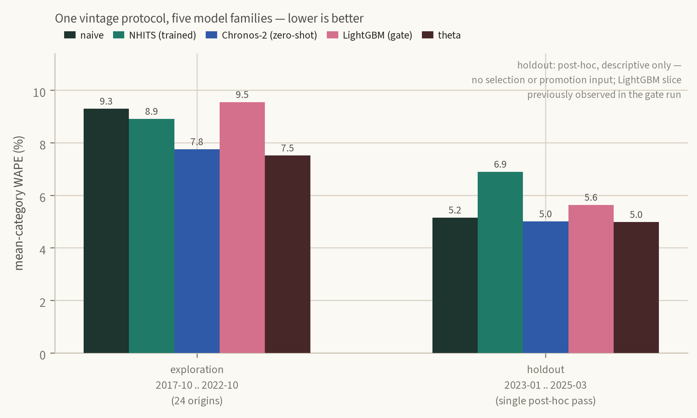
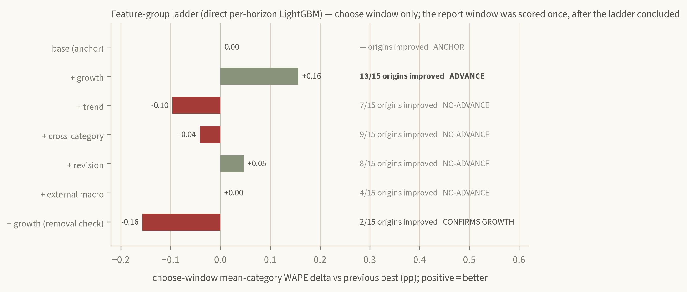
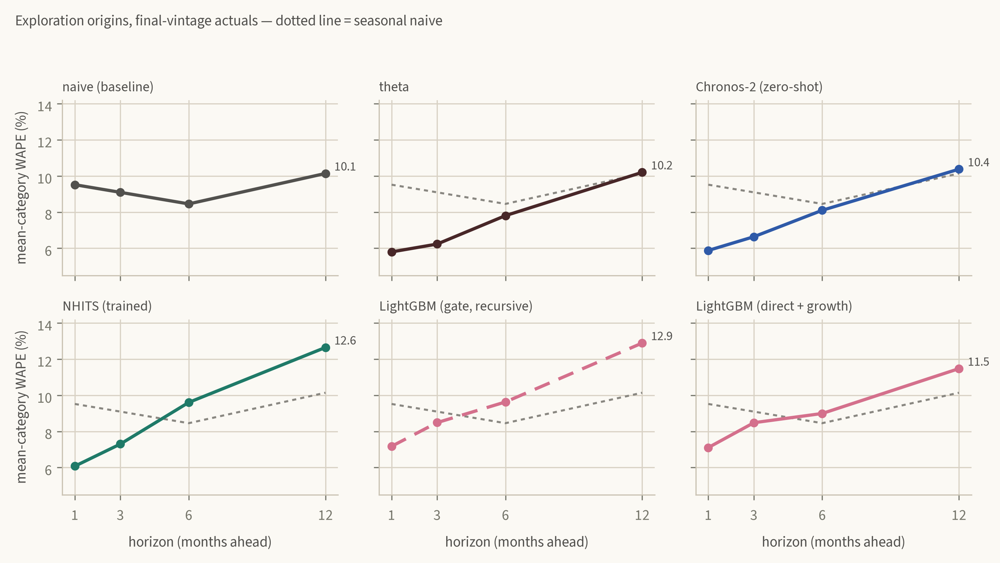

# retailpred — field notes

**An evidence-first forecasting platform** rebuilt from an undergraduate project. Every number below is measured, every model decision went through a predeclared gate, and the serving contract stays dark until a model earns the right to forecast.

[](https://github.com/oleeveeuh/retailPRED/actions/workflows/ci-cd.yml)
[](https://oleeveeuh.github.io/retailPRED/)
[](https://github.com/oleeveeuh/retailPRED/releases/tag/v2.0.0)
[](LICENSE)

**Live showcase → [oleeveeuh.github.io/retailPRED](https://oleeveeuh.github.io/retailPRED/)** · Portfolio → [oleeveeuh.github.io](https://oleeveeuh.github.io/)

## The scoreboard

| The question | The measured answer | Verdict | Evidence |
|---|---|---|---|
| Can one model forecast 30,490 Walmart item/store series better than naive, across an official 42,840-node hierarchy? | **WRMSSE 0.8133 vs 0.8697** (+6.48%), won all 5 rolling stability windows | ✅ **Promoted** — serves as the site's offline demo | [M4 benchmark](docs/v2/M4_M5_LIGHTGBM.md) · [stability](docs/v2/M4_M5_STABILITY.md) |
| Can global LightGBM beat naive forecasting 11 Census retail categories on revised history? | Mean category **WAPE 4.49% vs 6.35%** (+29%), all 11 categories improved, 5,324 folds | ✅ On revised history only | [M3 benchmark](docs/v2/M3_LIGHTGBM.md) |
| Then the harder question: what could it know at *forecast time*? | On 106 real ALFRED vintages (the archive of past data publications): **8.49% vs 8.16%** — the edge disappears | ❌ **Gate refused the model** | [Vintage gate](docs/v2/M3_VINTAGE_BACKTEST.md) |
| After the refusal: did any challenger — statistical, foundation, neural, feature-engineered, or a learned selector — clear the same vintage protocol? | The **theta method** ranked first (7.51% vs naive's 9.30% mean-category WAPE on exploration; lowest recorded holdout mean-category WAPE), Chronos-2 second; **no model passed the predeclared promotion criteria**, and serving stays fail-closed | ❌ **Frontier identified, gate still closed** | [Satellite findings](https://github.com/oleeveeuh/retailPRED-satellite/blob/main/FINDINGS.md) |
| Does the pipeline actually run — end to end, on real infrastructure? | **Executed on Databricks**: 13 Delta tables, dbt 20/20 green (first pass logged vacuous — the pipeline populated the tables after that dbt run), live Census pull merged (2,200 rows, cutoff Aug 2026) | ✅ [Execution ledger](docs/v2/DATABRICKS_RUN.md) | — |

Metrics: **WAPE** = weighted absolute percentage error — total absolute forecast error divided by total actual volume. **Mean-category** WAPE computes it separately for each of the 11 Census categories and averages the 11 numbers equally (the gate metric); **pooled** WAPE combines all observations, giving larger retail series more influence. The two aggregations can disagree — on the frozen holdout they resolved in opposite directions — so both are labeled wherever they appear, along with the actual source (**final-vintage** revised actuals govern the gate; **first-release** actuals are reported as the descriptive companion). **WRMSSE** = weighted root mean squared scaled error on the official M5 hierarchy. The **seasonal naive** baseline carries the year-ago value forward; **global LightGBM** is one gradient-boosted tree model trained across all 11 series at once; a **fold** is one scored forecast (a single series, origin month, and horizon).

**The failed gate is the headline, not a footnote.** A promotion gate written *before* measurement refused the model its author wanted to promote — and the system stayed honestly dark. Four other approaches were rejected by their own predeclared gates **on M5**: Chronos-2, a pretrained time-series foundation model used off the shelf (1.937 WRMSSE on the full hierarchy); NHITS, a neural forecaster; MinT-style reconciliation, statistical averaging that makes the hierarchy add up; and conformal intervals, an uncertainty-band method (69.38% coverage on high-volume series). On MRTS, Chronos-2 and NHITS were later benchmarked separately under predeclared protocols — Chronos-2 finished second to the theta method, NHITS further back; both MRTS holdout runs are descriptive only. [The gate document →](docs/v2/M3_VINTAGE_BACKTEST.md) · [The full research story, chapter by chapter →](https://oleeveeuh.github.io/retailPRED/#/story)

## Two datasets, two lessons

| | **Census MRTS** (Monthly Retail Trade Survey) — macro planning | **M5** (Walmart's public Kaggle demand dataset) — operational demand |
|---|---|---|
| Grain | 11 national monthly categories, millions of dollars | 30,490 item/store daily series |
| The catch | **Alive**: every month is published, then revised | **Frozen**: fixed snapshot, ends May 2016 |
| What it taught | Real-time forecasting is measurably harder than revised history — and the revision process itself is the next modeling frontier | Related-series pooling beats per-series models at scale; the hierarchy must add up exactly |

The tracks stay separate on purpose: national dollar categories are never presented as store/SKU demand.

## How it works


Delivery target: **[oleeveeuh.github.io/retailPRED](https://oleeveeuh.github.io/retailPRED/)** — the Pages workflow validates the snapshot contract before anything deploys, and the UI reports a missing snapshot as unavailable instead of inventing one.

## What is implemented

**The showcase, live** — every card below is rendered from governed evidence, and the screenshot is the real deployment:

<p align="center">
  
</p>

**The story behind the scoreboard** — the gate refusal kicked off a full investigation, told chapter by chapter in [the research story](#the-research-story) below (or on the [live story page](https://oleeveeuh.github.io/retailPRED/#/story)): where the failure lived, the repair attempts that failed, the theta method, the spent holdout, the wider search across foundation, neural, and feature-engineered challengers — every number from a frozen artifact, with themed research figures placed where they belong in the narrative.

### A governed data platform — revisions are first-class

The storage layer never overwrites history: bronze is append-only, silver is keyed by vintage, and gold is selected *as of* any moment. The entire point-in-time guarantee is three lines:

```python
eligible = clean.loc[clean["vintage_time"] <= pd.Timestamp(as_of)]
latest = eligible.groupby(["series_id", "observation_time"])["vintage_time"].idxmax()
return eligible.loc[latest]   # exactly what a forecaster could have known
```

On top of it: Census MRTS and FRED/ALFRED ingestion that fails closed (no synthetic fallback), causal monthly features shifted before aggregation, the official sparse 12-level M5 hierarchy with WRMSSE, and Databricks Delta + dbt models generated from the same declared specifications — 20 data tests green on the workspace's first pass (logged vacuous: the pipeline populated the tables afterwards).

### Model selection by predeclared gate

The gate criteria were written before the measurement and are enforced in code — the failed real-time verdict exists because this function said no:

```python
gate["passed"] = (
    gate["mean_category_wape_improved"]
    and gate["improved_series_count"] >= gate["series_count"] - 1
    and gate["acceptable_regressions"]
)
```

Around it: comparable rolling-origin folds (point scores: WAPE, MAE, RMSSE, bias; probabilistic: pinball loss, WIS, coverage), MLflow tracking with full provenance, a frozen portfolio decisions module that serving reads instead of "whatever trained last," and four documented rejections — Chronos-2, NHITS, MinT-style reconciliation, conformal intervals.

### A serving contract that stays dark until earned

Production requests are never approximated with a demo — they return a typed refusal with the exact action required:

```json
{"detail": {"code": "production_model_unavailable",
            "message": "The frozen portfolio does not authorize production inference.",
            "dataset": "m5",
            "required_action": "offline_demo_until_refit_on_current_data",
            "model_status": "promoted_point_champion",
            "serving_mode": "offline_demo_until_refit_on_current_data",
            "uncertainty_status": "research_only_failed_segment_gate"}}
```

The M5 champion is promoted for its frozen 2016 benchmark, not for production on current data — and its uncertainty stays behind the segment gate that refused it.

The React evidence page consumes the same contract, labels the fixture as historical, and hides calibrated uncertainty behind its (failed) promotion gate:

<p align="center">
  
</p>

### A live loop, executed on Databricks

Four scheduled serverless tasks — with the scoring task refusing while the portfolio has not authorized a champion:

```yaml
tasks:
  - pull_latest_census_release     # live Census -> versioned silver
  - score_promoted_model           # refuses until the gate passes
  - evaluate_realized_errors       # forecasts vs revised actuals
  - publish_snapshot_github        # contract-validated JSON -> live-data branch
```

Plus ALFRED vintage pulls behind a fail-closed series mapping, vintage-safe seasonal-naive benchmarks frozen beside every forecast, and the full execution ledger in [DATABRICKS_RUN.md](docs/v2/DATABRICKS_RUN.md).

### The component inventory

- **Immutable contracts** for series, observations, releases, forecasts, actuals, model decisions, and BI extracts — with observation time, vintage time, explicit as-of selection, and no synthetic fallback.
- **Causal monthly features** (past information only) — target-derived lags, rolling statistics, and changes shifted before aggregation — plus comparable rolling-origin folds scored for point accuracy (WAPE, MAE, RMSSE, bias) and for calibrated uncertainty (pinball loss, WIS, coverage).
- **The official sparse 12-level M5 hierarchy**: revenue weights, WRMSSE, exact bottom-up aggregation, and nonnegative diagonal-variance WLS reconciliation.
- **Governed model selection**: Seasonal Naive and global LightGBM measured; NHITS, Chronos-2, reconciliation, and conformal intervals each rejected by their own gates on M5 — with Chronos-2 and NHITS separately benchmarked on MRTS under predeclared protocols (no cross-dataset elimination; see D012). Retired v1 labels are excluded from v2 selection.
- **A live-loop foundation, executed on Databricks**: ALFRED vintage pulls behind a fail-closed series mapping, a four-task scheduled pipeline (ingest → fail-closed scoring → realized errors → snapshot publish), vintage-safe seasonal-naive benchmarks frozen beside every forecast, immutable first-release-plus-revised realized tracking, and a [versioned snapshot contract](docs/v2/SNAPSHOT_CONTRACT.md). Scoring stays refused until the [vintage gate](docs/v2/M3_VINTAGE_BACKTEST.md) promotes a champion — by design.
- **A fail-closed FastAPI `/api/v2`** returning typed unavailable states for unapproved production, stale-data, incompatible-model, and uncalibrated-uncertainty requests.
- **Nine governed Tableau views** backed by an aggregate-only Hyper extract, including MRTS research-window, feature-ladder, horizon, and paired-confidence diagnostics checked against the same frozen model decisions — published to Tableau Public with all nine views (owner release 2026-11-10); republishing after an extract rebuild is a manual owner action.
- **A React evidence page** (this deployment) backed by a deterministic 2016 M5 fixture — explicitly historical, never a current forecast.
- **MLflow tracking proof** locally with data hash, Git revision, parameters, metrics, and artifacts.

## Run and verify

Prerequisites: Python 3.11, Node.js 24 LTS, Git.

```bash
git clone https://github.com/oleeveeuh/retailPRED.git && cd retailPRED
make setup          # Python 3.11 venv + frontend dependencies
make verify         # publication gate → 221 Python tests → frontend type-check, lint, build
```

Run the restricted API and frontend locally:

```bash
.venv-v2/bin/python -m uvicorn backend.main:app --port 8000   # terminal 1
cd frontend && npm run dev                                     # terminal 2
```

`GET /api/v2/health` separates service health from model availability and data freshness; `GET /api/v2/models` returns frozen decisions; `POST /api/v2/forecasts` serves only the documented fixture — production mode fails closed with a typed 409.

## Reproduce the measurements

Census benchmarks require the named annual-revision workbook and an explicit vintage timestamp:

```bash
make benchmark-mrts WORKBOOK=/path/to/benchsales26.xlsx VINTAGE_TIME=2026-11-02T00:00:00+00:00
make probabilistic-mrts WORKBOOK=/path/to/benchsales26.xlsx VINTAGE_TIME=2026-11-02T00:00:00+00:00
```

M5 requires the four competition files under `data/v2/source/m5/` (user-supplied, not redistributed — checksums and validation in [the source record](docs/v2/M4_M5_SOURCE.md)):

```bash
make validate-m5 && make baseline-m5 && make rolling-m5 && make rolling-reconcile-m5 && make probabilistic-m5
```

Real-time vintage evaluation requires a FRED key and the completed series mapping (`config/fred_mrts_mapping.json`):

```bash
make fetch-alfred-mrts END_YEAR=2026 FRED_API_KEY=$FRED_API_KEY   # ~15 min, 106 vintages × 11 series
make vintage-backtest-mrts
```

The Tableau workbook rebuilds from tracked aggregate reports: `make bi-extracts AS_OF_DATE=2026-11-03 && make setup-tableau && make tableau-workbook`.

## Repository map

```text
forecasting/          contracts, causal features, models, evaluation, hierarchy, benchmarks
retailpred/           platform (Delta binding, snapshot contract) + live loop (ingest, scoring, realized)
databricks/           serverless jobs and Asset Bundle resources; warehouse/ holds the dbt project
backend/              restricted FastAPI v2 surface; legacy v1 code isolated behind a flag
frontend/             showcase landing + governed evidence page (GitHub Pages)
bi/                   governed extracts, manifest, Hyper file, Tableau workbook
scripts/              reproducible benchmark, ingestion, and publication-gate entry points
tests/                temporal, platform, model, serving, BI, and parity tests
docs/v2/              decisions, measured results, limitations, execution ledger
project_root/         preserved undergraduate pipeline; never a v2 input
```

## Limits — stated, not hidden

- MRTS benchmark numbers use a 2026 revised history, not origin-available values. LightGBM remains a **development challenger**: the real-time gate refused it.
- M5 ends in 2016 — its champion is valid for that benchmark, not current retail behavior.
- No uncertainty method passed its gate; nothing on this site shows invented confidence bands.
- dbt and Databricks code is executed on a Free Edition workspace; no paid-tier features, remote MLflow server, or production SLA is claimed.
- The live snapshot chain activates only after the vintage gate promotes a champion and the schedule runs; until then the site serves the historical fixture and labels it as such.

## The research story

The ten-chapter field-notes version of what happened after the gate said no — the same story the [live story page](https://oleeveeuh.github.io/retailPRED/#/story) tells, with figures generated by the satellite's themed figure scripts. Every number below comes from a frozen artifact; every result is labeled with its window (exploration 2017-10..2022-10, report 2021-01..2022-10, the frozen holdout 2023-01..2025-03) and its actual source.

### 01 — the gate that said no

*On revised history the champion looked unbeatable; the one test that mattered disagreed.*

On revised history, the global LightGBM looked genuinely good: 4.49% mean-category WAPE against the seasonal naive's 6.35%, better in all 11 Census retail categories. That result earned it a shot at the real thing. The vintage gate had been written before the measurement, in the style I want to keep: fix the criteria first, then let the data answer.

The gate rebuilt every training set from 106 real ALFRED vintages — only what was publishable at each forecast origin — and scored 1,408 folds — one scored forecast per series, origin, and horizon. Real time flipped the result: 8.49% vs the naive's 8.16%, with LightGBM improving just 4 of 11 categories. It failed on all three predeclared criteria — mean improvement, 10-of-11 category wins, bounded regressions — and the serving decision stayed fail-closed. No champion, no hand-waving — the pipeline kept serving nothing, which is what an honest gate is for. ([vintage gate document](docs/v2/M3_VINTAGE_BACKTEST.md))

### 02 — where the failure lives

*Before rebuilding anything, find out exactly where the edge died.*

First, reproduction: the research satellite — this project's companion repository for controlled investigations — re-ran the failed gate with pinned versions and got the naive back to the digit — max diff 0.0. Nothing was wrong with the platform. The failure belonged to the model.

The decomposition that followed changed how I read every metric in this project. Pooled across folds (volume-weighted), the LightGBM actually beat naive even in real time — 5.87% vs 6.54% on exploration origins. The gate metric weights categories equally, and the model lost exactly there: it won big, quiet categories and lost small, volatile ones. By horizon, it won the one-month-ahead forecast and lost the twelve-month one badly — the recursive rollout feeds its own drift back eleven times, and clothing degrades monotonically from +0.6pp to −8.5pp. By regime, every point of advantage came from the pandemic disruption. And the category regressions ranked by revision magnitude (Spearman rank correlation −0.755): loudly-revised categories were where it bled. Training staleness, the first suspect, measured constant and was ruled out. ([satellite forensics](https://github.com/oleeveeuh/retailPRED-satellite/blob/main/FINDINGS.md))

### 03 — five repair ideas did not hold up

*Each repair was predeclared — one hypothesis, one commit, one verdict — and each refutation narrowed the search space.*

Drop the preliminary training rows, the values most likely to be revised later (H1): refuted — trimming never helped (−0.41pp on the report window). The poison, if any, was not in the fit-row targets. Give the model revision metadata — counts, magnitudes, value ages (H2): refuted (−0.68pp); the tree ensemble could not turn those reliability notes into sharper targets.

Change the target transformation (H4): every alternative lost — year-over-year differencing −0.88pp, STL-detrended inputs −1.06pp, and a plain log-level target collapsing outright at −19.07pp. That last one was the most useful negative result in the project: the scale-free log(value/lag₁₂) target — the log of this month's value over the year-ago value, a pure growth rate — is load-bearing, and nothing replaces it. Shrinking the model toward naive (H3) did help (+1.18pp, 7/11 categories) — real, but short of the gate's category breadth — and blending theta into the mix helped against naive while diluting theta on every window (H3b). Nothing repaired LightGBM into a gate-passer — so the search moved from patching the model to finding a better method outright. ([hypothesis table](https://github.com/oleeveeuh/retailPRED-satellite/blob/main/FINDINGS.md))

### 04 — the theta method

*A classical statistical method from 2000 beat naive in real time — per-series, with almost no parameters.*

The satellite's fifth hypothesis was the one I almost skipped: the **theta method** (Assimakopoulos & Nikolopoulos 2000) is a classical statistical forecasting approach that combines a smoothed estimate of the series' recent level with its longer-term trend. It fits very few parameters — one smoothing constant chosen in-sample, often written θ — and uses no engineered feature panel and no cross-series training, which makes it comparatively difficult to overfit on a small collection of monthly series. No learned features, no training panel, nothing to leak.

Under the same vintage protocol it beat naive on both exploration-side windows: 7.51% vs 9.30% mean-category WAPE on the exploration origins (2017-10..2022-10), winning 9 of 11 categories; and 7.02% vs 10.51% on the report window (2021-01..2022-10), winning 10 of 11.

<p align="center">
  
</p>

*Mean-category WAPE by evaluation window (lower is better): theta beats naive on every one — 7.51% vs 9.30% exploration, 7.02% vs 10.51% report, 4.98% vs 5.15% on the single frozen holdout run. The holdout panel also carries LightGBM's gate slice (5.64%, 5/11), previously observed in the gate run. The regime-switch policy appears on the report window only (7.43%).*

The mechanism is legible: theta tracks trend at short horizons, and at the one-month horizon through the 2021–22 inflationary rebound it scored 3.1% where naive carried 11.5% — naive was still anchoring on year-ago crash values. For the first time since the gate, a challenger had a case. ([window summary](data/v2/evidence/mrts_research_windows/mrts_window_summary.json))

### 05 — the holdout narrowed the claim

*A holdout gets spent the moment you look at it. This one was spent exactly once, and it said no — and a later reporting-only audit measured exactly how much the answer depends on choices the gate had already frozen.*

The 2023–2025 origins had been reserved the whole investigation. One run, predeclared: the theta method needs ≥10 of 11 categories to beat naive for the case to continue. The result — 4.98% vs 5.15% mean-category WAPE, +0.17pp, with only 7 of 11 categories improved. Criterion 2 failed. On final-vintage actuals, theta's dominance was regime-specific: real on volatile targets, unresolved on the settled ones.

A later reporting-only audit (protocol committed before recalculation; every verification gate reproducing the frozen record) measured the uncertainty the frozen run never had, and it complicated the picture without touching the verdict. Origin-block bootstrap resampling (whole origins, 2,000 draws) puts the mean-category advantage at +0.17pp with the interval −0.17..+0.54 — covering zero. Under pooled WAPE the sign flips and resolves: naive better by 0.77pp (interval −1.24..−0.36, excluding zero). Against first-release actuals — the same stored predictions scored against what was operationally evaluable at each target month — theta's advantage returns: +1.19pp (interval +0.83..+1.57), 10 of 11 categories. The aggregation choice and the actual choice each change the conclusion, which is exactly why the audit reports both and why neither was allowed to move the gate. **Theta had the lowest recorded mean-category WAPE, but failed the original final-vintage 10-of-11 promotion criterion.**

The original theta holdout decision was computed once and frozen; the later metric audits and the predeclared post-hoc Chronos and NHITS benchmarks reused the stored window descriptively, without changing the original selection rule or the promotion verdict. For the record: theta's 4.98% was still better than the frozen gate's LightGBM scored on those same origins — 5.64%, with only 5 of 11 categories improved, re-aggregated from the stored gate folds under a predeclared reporting-only protocol — and theta vs LightGBM is the one holdout ranking the interval resolves (+0.65pp, wholly positive). The serving decision stayed fail-closed. Naive stands. ([holdout record and scorecard](https://github.com/oleeveeuh/retailPRED-satellite/blob/main/results/holdout_scorecard.md))

### 06 — two questions about time

*How much history does a forecaster need? Fewer questions have cleaner negative answers.*

Question one: can the past N years predict 2020? Measured on a designated pre-shock/in-shock split. From 2019 origins: no — nothing beat naive on mean-category WAPE (all methods 18.4–19.2% vs naive 18.5%); the collapse was not in any window of pre-2020 history. From 2020 origins, after the shock started: yes — LightGBM beat naive in 8 of 11 categories. Window length itself was second-order: the spread across 5/10/20/full-year training panels was ~1–2pp with inconsistent direction. The five-year minimum training window stays defensible.

Question two: can a decade or two of history predict the 2020s? The theta method scored 8.09/8.02/8.03% mean-category WAPE with 10y/20y/full windows — ten years is enough, two decades add nothing. What moved predictability was phase, not window: theta halved naive's error on 2021 targets (7.9% vs 16.8%), and naive re-took the lead on 2023-target folds (6.86% vs ~7.3%). Adaptive methods own the volatile phase; naive owns the settled tail. The 2020s are also a noisier data regime independent of volatility — preliminary→final revision magnitudes remain ~60% larger than the 2010s (median 1.96% → 3.17%). ([window studies](https://github.com/oleeveeuh/retailPRED-satellite/blob/main/FINDINGS.md))

### 07 — the selector: complexity without the win

*A learned switching layer was a valid experiment with a predeclared win rule — and the measurement said the complexity was not justified.*

The regime-switch policy: a small LightGBM classifier on causal, point-in-time features (trend strength, volatility, revision churn, lagged performance), calibrated with isotonic regression on held-out scores — each earlier origin left out of its own calibration in turn — calling naive or theta per category and origin whenever its confidence that theta wins clears a predeclared threshold (τ = 0.50). Trained on 77 pairs from those earlier origins (7 origins × 11 categories), then evaluated once on the report window — n = 99 pairs (9 origins × 11 categories), with every confidence interval resampling whole origins 2,000 times (forecasts made in the same month rise and fall together).

<p align="center">
  
</p>

*Per-category WAPE delta, naive minus policy, on the report window; positive (blue) means the policy was better. Ten of eleven categories improved, and the one loss is sporting goods (−1.55pp).*

It beat naive in 10 of 11 categories (7.43% vs 10.51%, +3.08pp, CI +0.70..+5.13) and beat the fixed 0.5/0.5 blend (7.77%). It did not beat pure theta (7.02%) — the entire confidence interval for the gap sits below zero (−0.59..−0.21), so the second guardrail — beat everything — failed and the predeclared rule earned a findings document, not a promotion.

<p align="center">
  
</p>

*The frozen τ = 0.50 sits in the flat bottom of the out-of-fold sweep on the training window (11.71%); the diamond is the single frozen report-window evaluation (7.43%) — the sweep's floor does not transfer across the regime boundary.*

The diagnosis is structural: the report window is single-regime (theta wins 72.7% of pairs there), and a switch has no surface to pay off when one model is already near-ceiling. The measured defect is calibration — the Brier score (calibration error, lower is better) degraded from 0.155 on the training window to 0.276 on the report window, worse than always calling theta at the 72.7% base rate. A learned switching layer that cannot calibrate across regime changes does not justify its additional complexity — the conclusion is a measured no, and the layer was not carried forward. ([policy findings](https://github.com/oleeveeuh/retailPRED-satellite/blob/main/POLICY_FINDINGS.md))

### 08 — foundation and neural models did not displace theta

*Chronos-2 and NHITS had been tested on M5 only. Two predeclared MRTS benchmarks put them under the same vintage protocol — and theta stayed first.*

Chronos-2 (a zero-shot foundation model — a large pretrained time-series network used off the shelf, no fine-tuning) and NHITS (a neural forecaster trained from scratch) had been evaluated and rejected on M5, but those results could not determine their MRTS performance: M5 is 30,490 granular daily series, and nothing about its failure modes transfers to 11 directly-forecast monthly national series. The satellite therefore predeclared each benchmark in writing — frozen configuration, reading rules, and the rule that holdout runs are evaluated exactly once and stay descriptive — before any code ran, then measured both on the identical origin grid, availability rule, actuals, and metrics as every other candidate. The M5 and MRTS studies share infrastructure, not conclusions.

| Family | Model | Exploration | Holdout |
|---|---|---:|---:|
| Classical statistical | theta method | **7.51%** | **4.98%** |
| Foundation | zero-shot Chronos-2 | 7.75% | 5.00% |
| Neural | trained NHITS | 8.91% | 6.90% |
| Tree ensemble | gate LightGBM | 9.55% | 5.64% |
| Baseline | seasonal naive | 9.30% | 5.15% |

*Mean-category WAPE, identical origin grid. Holdout column: post-hoc descriptive for Chronos and NHITS (single predeclared pass, no confidence intervals, no selection input); the LightGBM slice was previously observed in the gate run.*

Zero-shot Chronos-2 was genuinely competitive: +1.54pp over naive on exploration (9 of 11 categories), +1.80pp over the gate LightGBM, trailing the theta method by 0.24pp and beating it in only 3 of 11 categories. Its 5.00% holdout score versus theta's 4.98% is post-hoc and descriptive — a ranking observation, not evidence. Cross-learning and fine-tuned Chronos variants remain untested. Chronos showed that a modern zero-shot foundation model could be competitive on MRTS, but it did not displace theta.

Trained NHITS — rebuilt from scratch at every forecast origin on exactly the vintage-safe panel available then, hyperparameters fixed, no search — landed one step further back: 8.91% on exploration, beating naive by 0.39pp (6 of 11 categories) and the gate LightGBM by 0.64pp (8 of 11), losing to theta by 1.40pp (1 of 11). At h=1 it was competitive (6.08% vs theta's 5.80%); by h=12 it degraded to 12.64%, effectively the recursive gate model's position (12.89%). On the post-hoc descriptive holdout it scored 6.90% — worse than naive's 5.15%, improving only 2 of 11 categories versus naive and 1 versus theta — degrading monotonically with horizon from 5.20% to 8.75%. No prediction was negative and none was clipped; no confidence interval or promotion claim applies to that run; alternative NHITS configurations remain untested because the predeclaration prohibited a search. NHITS learned useful short-horizon structure during the volatile exploration period, but paid the largest calm-regime penalty of the three challengers and reproduced the long-horizon weakness already seen in learned models.

<p align="center">
  
</p>

*The identical-protocol comparison. On exploration the order is theta 7.51% < Chronos 7.75% < NHITS 8.91% < naive 9.30% < gate LightGBM 9.55%; on the calm holdout the learned and trained approaches fell below naive (LightGBM 5.64%, NHITS 6.90%) while Chronos stayed narrowly ahead of it (5.00%) — the modern methods' advantages compressed sharply outside the volatile regime, and theta's did not. Neither holdout number is a promotion claim.* ([Chronos benchmark](https://github.com/oleeveeuh/retailPRED-satellite/blob/main/CHRONOS_MRTS.md) · [NHITS benchmark](https://github.com/oleeveeuh/retailPRED-satellite/blob/main/NHITS_MRTS.md))

### 09 — feature engineering reached a measured ceiling

*Direct per-horizon models, a frozen feature-group ladder, and a challenger that still loses to theta with a resolved interval.*

The last open question: could a learned model with the right inputs beat theta, not merely naive? The test was a predeclared feature-group ladder built on direct per-horizon models — one model per horizon instead of a recursive rollout — removing recursion as a confound. Feature groups were evaluated on the choose window only (the 15 exploration origins before 2021); the report window was computed exactly once, after the ladder selected its final configuration; an elastic-net arm used per-origin inner cross-validation for regularization; and five external macro series — CPI, unemployment, consumer sentiment, the federal funds rate, real disposable income — were ingested as vintages aligned point-in-time, so no today-downloaded value could enter a past origin.

Every rung was measured, and only one advanced. Growth features advanced (+0.16pp, improving 13 of 15 choose origins). Trend and cross-category context were rejected outright; revision metadata's +0.05pp failed origin stability (8 of 15) and was rejected for instability; external macro added exactly nothing (+0.00pp, 4 of 15 origins). Removing growth reversed its gain, confirming growth was load-bearing. The elastic net trailed the LightGBM on identical features (8.65% vs 8.39% on the choose window). The ceiling was measured, not assumed.

<p align="center">
  
</p>

*The feature-group ladder on the choose window — incremental mean-category WAPE delta vs the previous best rung, origin stability, and the frozen verdict. The report window was scored once, after the ladder concluded.*

The surviving configuration — **direct LightGBM + growth** — still loses to theta with the interval resolving the loss, on every window, under final-vintage actuals: full exploration 9.02% vs 7.51% (−1.50pp, CI −2.45..−0.73); report 9.85% vs 7.02% (−2.82pp, CI −4.69..−1.17). Against naive it is unresolved (+0.28pp, CI −0.46..+1.14). Direct forecasting did repair part of the recursion problem — at h=12 it improved the recursive gate model by 1.42pp (12.89% → 11.47%) — but it still trailed theta at every horizon (h=12: 11.47% vs 10.20%). Against first-release actuals the engineered model beat naive by 2.23pp, improving 10 of 11 categories, and still lost to theta by 1.28pp with the interval wholly negative (−2.32..−0.44). Feature enrichment repaired part of LightGBM's long-horizon behavior, but it did not reveal a learned model capable of beating theta — and for this design, the archive-side enrichment route is now closed.

<p align="center">
  
</p>

*Exploration-window mean-category WAPE by horizon, one panel per model (dotted line = seasonal naive): theta and Chronos hold near 10.2–10.4% at twelve months; trained NHITS degrades to 12.6% and the recursive gate LightGBM to 12.9%; direct forecasting with growth improves the recursive model to 11.5% — 1.42pp of recursion repaired — and still trails theta at every horizon.* ([feature-ladder design and results](https://github.com/oleeveeuh/retailPRED-satellite/blob/main/H7_FEATURE_LADDER.md))

### 10 — what remains open

*The gate is still closed, on purpose. Here is exactly what would reopen it — and what is now closed for good.*

The serving decision stays fail-closed until a challenger passes a predeclared gate — that has not changed since the first refusal, and nothing in the satellite challenged it. One route is now closed: archive-side feature enrichment, as designed and tested in chapter 09, is closed for this design. The remaining legitimate routes are specific: accumulate genuinely new forecast origins for the future re-gate (roughly 24 calm origins, ≈ end of 2027), then re-gate with the theta method as a third benchmark beside naive and LightGBM; per-training-row historical alignment of external variables, which the ladder did not test (its external context was origin-constant); higher-frequency nowcasting inputs or a MIDAS-style design that mixes frequencies; a switching policy only if it demonstrates calibration across regime changes; alternative Chronos or NHITS configurations only under a new predeclaration and future evaluation data; and owner-confirmed prospective thresholds recorded before the re-gate window opens. Nothing in the plan revises the original gate retroactively — the re-gate design ([REGATE_DESIGN.md](https://github.com/oleeveeuh/retailPRED-satellite/blob/main/REGATE_DESIGN.md)) is drafted two years early precisely so no threshold gets chosen after seeing data.

<p align="center">
  
</p>

*Reliability of the selector's confidence that theta wins: training-window out-of-fold deciles (sage, n=77, Brier 0.155) transfer badly to the report window (diamonds, n=99, Brier 0.276) — worse than always calling theta at the 72.7% base rate. Base-rate-robust calibration is the spec for any future switching policy.*

A switch only pays on regime-mixed windows, so any future attempt needs evaluation windows that actually mix regimes — and a calibrator that survives base-rate movement between windows. Isotonic on 77 out-of-fold rows collapsed to a single step and transferred badly across the regime boundary; base-rate-robust calibration is the spec for whoever tries next. The platform keeps running while the evidence accumulates: realized-error rows mature month by month, and every additional calm origin is another block of evidence the next challenger will be judged on. Everything above is recorded, versioned, and linked — including the parts that failed. Especially those. ([re-open conditions](https://github.com/oleeveeuh/retailPRED-satellite/blob/main/FINDINGS.md))

## The v1 → v2 story

**v1 (GCP + Airflow).** An Airflow-scheduled pipeline expanded monthly Census values into synthetic weekly rows, computed features with inclusive rolling windows (the target month leaked into its own features), served per-category model pickles through a SQLite-backed FastAPI, and presented the results on a Vercel dashboard. The orchestration worked — jobs ran, data flowed, the site rendered. That sharpens the diagnosis: **v1's failures were not operational. They were epistemic.** Its validation snapshot showed 9.76% MAPE for LightGBM against 14.11% for seasonal naive, but the 429 "validation rows" were monthly actuals repeated across weekly targets — pseudo-replication flattering every model — and the neural entries were heuristic outputs from a retired pipeline. The published demo claimed 90.2% accuracy from static data no deployed model had produced. The stack delivered numbers; nothing in it could say what the numbers meant.

**The rebuild decision.** Orchestration was never the problem, so v2 asked what the pipeline should *enforce*, not just schedule. Three requirements drove the platform choice:

1. **Revisions first-class.** Census values change after publication, so storage needed immutable vintage-keyed rows and point-in-time selection — semantics Delta Lake implements natively and a relational warehouse only provides by hand-building slowly-changing tables.
2. **Auditable governance.** Declared schemas, quality gates that fail closed, and an execution ledger — Unity Catalog and Delta table properties provide both without a separate audit stack.
3. **The repository is the deployment.** One bundle definition in CI, no console drift, zero-cost serverless for a monthly pipeline.

The honest tradeoffs are stated: v2 accepts platform lock-in in exchange for native versioning, and it drops v1's always-on serving posture, because the measurement work showed no MRTS model had earned live inference. Airflow remains a fine orchestrator.

**What the rebuild proved.** The same 11 categories, measured properly: LightGBM beats naive by 29% on revised history — then loses in real time, where a gate written before the measurement refused it. On M5, the global LightGBM was promoted and Chronos-2, NHITS, MinT-style reconciliation, and conformal intervals were rejected by their own gates; on MRTS, every challenger that followed — including zero-shot Chronos-2 and trained NHITS under predeclared benchmarks — failed or fell short of the theta method, and the gate stayed closed. **v1 could not have produced any of those sentences, because nothing in it could fail.**

## Data, artifacts, and licensing

Tracked v2 assets are contracts, tests, checksums, aggregate reports, the aggregate-only Hyper extract, and the deterministic demo fixture. Raw downloads, canonical tables, fold-level predictions, trained weights, databases, logs, and secrets are ignored. M5 source files are user-supplied and not redistributed; FRED series retain their own provider terms; the MIT license covers repository code only — it does not relicense upstream datasets.

An earlier commit exposed a local `.env`; the credentials were rotated and the path was removed from reachable history. Report any residual secret privately before opening a public issue.

The undergraduate implementation is retained on the `v1-undergrad` tag; its weekly expansions, inclusive features, randomized fallbacks, and heuristic outputs are not v2 evidence. The full diagnosis is in [the original audit](docs/v2/AUDIT.md).
