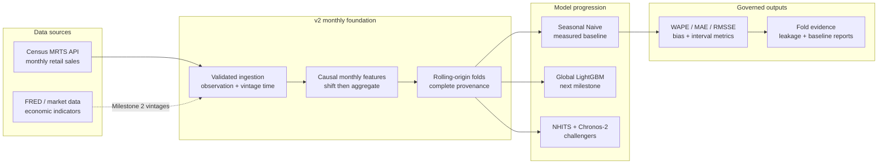
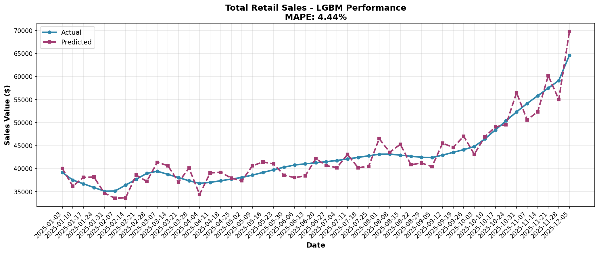

# RetailPRED

> **v2 rebuild active:** Milestone 1—the leakage-safe native-monthly foundation—is complete. The original undergrad implementation is preserved as `v1-undergrad`; its published metrics are historical evidence, not the v2 benchmark. See [`docs/v2/STATUS.md`](docs/v2/STATUS.md).

Leakage-safe monthly forecasting for 11 U.S. retail categories, with versioned Census ingestion, rolling-origin evaluation, and an auditable path from a simple baseline to modern global models.

[](https://retail-pred.vercel.app)
[](https://www.python.org)
[](https://nodejs.org)
[](LICENSE)

## Problem

Monthly retail sales series published by the U.S. Census Bureau's [Monthly Retail Trade Survey (MRTS)](https://www.census.gov/retail/mrts.html) are revised and released after the observation month. RetailPRED v2 asks a narrower, testable question: how accurately can each category be forecast at its native monthly frequency using only information available before the forecasted month?

The original project expanded monthly totals into synthetic weekly/daily targets. That made the apparent dataset larger without adding independent observations and introduced same-row target leakage in rolling features. v2 preserves that work as historical evidence while replacing its data and evaluation foundation.

## Current v2 foundation

- **Canonical monthly contracts** for series, observations, releases, forecasts, and actuals.
- **Native-monthly Census ingestion** with explicit errors—failed requests never become generated retail data.
- **Point-in-time dataset selection** across observation and vintage timestamps.
- **Causal features** whose rolling, difference, and change calculations are shifted before aggregation.
- **Rolling-origin evaluation** with expanding or sliding windows and recorded origin, horizon, cutoff, vintage, model version, and actual source.
- **Point and probabilistic metrics:** WAPE, MAE, RMSSE, bias, pinball loss, weighted interval score, coverage, and interval width.
- **Measured Seasonal Naive baseline:** 5,324 category/origin/horizon rows on the Census 2026 revision vintage; mean category WAPE 6.35%.
- **Versioned platform foundation:** immutable bronze extracts, versioned silver observations, as-of gold snapshots, idempotent merges, and fail-closed quality gates.

See the [Milestone 1 baseline](docs/v2/M1_BASELINE.md), [leakage report](docs/v2/LEAKAGE_REPORT.md), [data-platform architecture](docs/architecture/data_platform.md), and [implementation status](docs/v2/STATUS.md).

## Architecture



## Dataset

| | |
|---|---|
| **Source** | U.S. Census Bureau MRTS [time-series API](https://api.census.gov/data/timeseries/eits/mrts) and named annual-revision workbooks |
| **Scope** | 11 retail categories (auto dealers, building materials, clothing, electronics, food & beverage, furniture, gasoline stations, general merchandise, health & personal care, sporting goods, total retail sales) |
| **Granularity** | One independent seasonally adjusted value per category/month |
| **Measured baseline history** | January 2010 → December 2025 from the Census 2026 revision workbook |
| **Evaluation** | Monthly rolling origins, minimum 60-month training window, horizons 1/3/6/12 months |
| **Generated data policy** | Raw/canonical downloads and fold-level outputs live under ignored `data/v2/`; tracked reports contain source URL, checksum, and declared aggregates |

## Integrity guarantees and limits

- Target-derived features at month *t* depend only on values through *t-1*.
- Duplicate series/month/vintage keys, missing months, non-month-start timestamps, naive provenance timestamps, and non-finite values fail validation.
- Backtests never random-split time series and always record their data vintage and actual source.
- The current baseline uses revised Census history. It is not yet a true real-time-vintage backtest; historical release reconstruction is Milestone 2.
- The React/FastAPI product surface still serves preserved v1 artifacts and is not yet connected to the v2 forecasting modules.

## v1 historical results (not the v2 benchmark)

The frozen v1 snapshot below comes from [`training_outputs/validation_metrics.json`](training_outputs/validation_metrics.json), generated 2026-02-14 by comparing logged weekly predictions against published Census actuals. It is retained to show the starting point, but must not be quoted as authoritative v2 performance because the rows are pseudo-replicated and the training features contain the leakage documented above.

**Evaluation window:** weekly predictions dated 2025-01-05 → 2025-10-26 (the weeks with backfilled actuals). Trained on pre-2025 data only.

| Model | Avg MAPE | Categories | Validated samples | Notes |
|---|---|---|---|---|
| **LightGBM** | **9.8%** | 11 | 429 | Best model; SHAP-explainable; used as the default |
| **RandomForest** | **10.1%** | 11 | 429 | Close second; SHAP-explainable |
| SeasonalNaive | 14.1% | 11 | 473 | Baseline (same week last year) |
| PatchTST* | 17.9% | 10 | 430 | Legacy-pipeline label — see note |
| TimesNet* | 18.6% | 10 | 430 | Legacy-pipeline label — see note |
| AutoARIMA | 34.8% | 7 | 301 | Failed to train on 4 categories; poor fit |

\* **About PatchTST/TimesNet:** a genuine neural implementation (Nixtla `neuralforecast`) was evaluated in an earlier training pipeline that is no longer part of this repository. The rows logged under those names — and the MAPEs above — come from a trend/seasonal heuristic used after that pipeline was retired; no transformer weights are shipped here. AutoETS was removed entirely after failing badly on the 2025 distribution shift.

Per-category LGBM MAPE ranges from **5.9%** (clothing) to **15.1%** (sporting goods) — full breakdown in [`training_outputs/validation_metrics.json`](training_outputs/validation_metrics.json).

Sample diagnostic generated by the training pipeline (Total Retail Sales, LGBM — per-chart MAPE computed over the full plotted year, which spans more weeks than the validation window above):



**What is *not* claimed:** this is not a production system, there is no deployed backend (the live demo is a static build with pre-generated data), forecasts for 2026 are unvalidated, and the models are trained on ~10 years of one country's monthly retail aggregates — small data, wide error bars.

## Repository structure

```
retailPRED/
├── retailpred/platform/         # bronze/silver/gold contracts and local reference store
├── forecasting/                # v2 contracts, ingestion, features, models, evaluation
│   ├── data/                   #   Census API/workbook + canonical vintage-aware dataset
│   ├── features/               #   leakage-safe native-monthly features
│   ├── models/                 #   Seasonal Naive baseline
│   └── evaluation/             #   rolling origins + point/probabilistic metrics
├── scripts/                    # v2 ingestion and baseline entry points
├── backend/                    # FastAPI service
│   ├── api/                    #   routes, schemas, scenario/category/export endpoints
│   ├── ml/                     #   inference, feature computation, training scripts
│   │   └── models/             #   22 trained .pkl models (LGBM + RandomForest × 11)
│   ├── services/               #   prediction, scenario, economic-context logic
│   └── db/                     #   SQLite helpers + schema migrations
├── frontend/                   # React 19 + TypeScript + Vite dashboard
│   └── public/demo-data/       # pre-generated JSON for the static demo
├── project_root/               # preserved v1 training pipeline
│   ├── etl/                    #   legacy-only fetchers/builders
│   └── data_multi_resolution/  #   frozen v1 evidence; never v2 input
├── data/                       # ignored v2 generated data + runtime SQLite DB
├── training_outputs/           # validation metrics, training report, diagnostics
├── dags/                       # Airflow DAG: weekly validation loop
├── tests/                      # pytest suite (see "Verify")
└── docs/                       # methodology, API reference, web-app guide
```

## Quick start

**Prerequisites:** Python 3.11, Node.js 20, Git. No API keys are needed to run the backend, frontend, or tests — only the optional data-fetching scripts use them. Python 3.11 is pinned in `.python-version`; `requirements-dev.lock` is the complete local/CI verification environment.

```bash
git clone https://github.com/oleeveeuh/retailPRED.git
cd retailPRED

# --- Backend (FastAPI, port 8000) ---
cd backend
python3.11 -m venv venv && source venv/bin/activate
pip install -r requirements.txt
# initialize an empty SQLite database (the populated DB is not tracked)
python -m db.migrations --schema-path ../data/db/schema.sql --db-path ../data/retailpred.db
python -m uvicorn main:app --reload --port 8000

# --- Frontend (Vite, port 5173) ---  (new terminal, from repo root)
cd frontend
npm ci
npm run dev          # dev mode proxies to http://localhost:8000

# --- Or run everything at once ---
# from repo root: npm install && npm run dev
```

The pre-trained models are committed, so `/api/predict` works immediately. The database starts empty — forecast history accumulates as you use it.

### Verify

```bash
make setup                  # first run: locked Python dependencies + npm ci
make verify                 # backend tests + frontend type-check/lint/build
```

### Reproduce the v2 monthly foundation

```bash
make milestone1-check
make platform-check

# Optional live API ingestion; requires CENSUS_API_KEY
make fetch-mrts END_YEAR=2025

# Reproduce the measured baseline from a downloaded Census revision workbook
make baseline-mrts \
  WORKBOOK=/absolute/path/to/benchsales26.xlsx \
  VINTAGE_TIME=2026-11-02T00:00:00+00:00
```

The historical v1 model scripts remain in `backend/ml/` and `train.py`, but are not valid v2 retraining paths because they consume the frozen interpolated feature CSVs.

### Preserved v1 demo API

The current API and dashboard still serve v1 model artifacts. This example is retained for the historical demo and is not a v2 forecast contract.

```bash
curl "http://localhost:8000/api/predict?category=total_sales&model_name=LGBM&weeks_ahead=4&start_date=2026-01-05"
```

```json
{
  "model_name": "total_sales_LGBM_model",
  "forecasts": [
    {
      "date": "2026-01-05",
      "predicted_value": 65124.7,
      "confidence_interval_lower": 64670.0,
      "confidence_interval_upper": 65579.4
    }
  ],
  "shap_values": [{"feature": "lag_1w", "value": 210.4}],
  "features_used": 73
}
```

(Full endpoint reference: [docs/api.md](docs/api.md).)

## Environment variables

None are required to run or test the project. Optional, for data-fetching scripts:

| Variable | Used by |
|---|---|
| `CENSUS_API_KEY` | v2 native-monthly ingestion (`make fetch-mrts`) |
| `MRTS_API_KEY` | `weekly_validation.py`, `backfill_actuals.py` ([free Census key](https://api.census.gov/data/key_signup.html)) |
| `FRED_API_KEY` | `project_root/etl/fetch_fred.py` |
| `RETAILPRED_DIR` | Airflow DAG (path to repo on the runner) |

Copy [`project_root/.env.example`](project_root/.env.example) to `project_root/.env` for local use. `.env` files are git-ignored; never commit real keys.

## Limitations

- **Revision-vintage baseline:** the current v2 benchmark uses a 2026 revised history, not the values known at each historical forecast origin.
- **Small macro dataset:** 11 correlated national aggregate series are insufficient evidence for store/SKU demand behavior; M5 will be a separate operational use case.
- **Baseline only:** global LightGBM, NHITS, and Chronos-2 are planned but have not yet earned measured v2 results.
- **Serving integration pending:** the dashboard and API still expose preserved v1 artifacts and must not be described as the v2 model surface.
- **Historical v1 caveats:** weekly-replicated actuals, inclusive rolling windows, and heuristic neural-model labels apply to the frozen table above, not to v2.

## Future work

- Build bronze/silver/gold Delta tables and point-in-time source vintages.
- Add a global LightGBM champion and compare it on the exact Seasonal Naive folds.
- Evaluate NHITS and Chronos-2 only after the classical baseline and data contracts are stable.
- Add calibrated P10/P50/P90 forecasts and hierarchy-aware M5 evaluation.
- Replace the v1 serving path with model-registry-backed v2 forecasts and provenance.

## Data and model-artifact policy

- **v2 tracked:** contracts, tests, source/checksum manifests, methodology, and aggregate result reports.
- **v2 not tracked:** downloaded source data, canonical tables, fold-level predictions, trained weights, SQLite databases, logs, and `.env` files.
- **v1 historical evidence:** trained models, multi-resolution CSVs, validation metrics, diagnostics, and demo JSON remain tracked until their v2 replacements exist.
- **History note:** an earlier commit accidentally published `project_root/.env`; those credentials were rotated and the file removed from history. Report any residual secret you find per the security policy.

## License

[MIT](LICENSE). Census MRTS and FRED data are public domain / open government data.
