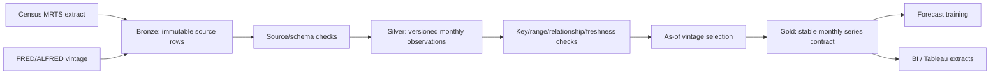

# Versioned data platform

Status: Milestone 2 platform and warehouse foundation implemented

## Contract first

RetailPRED uses the same logical table specifications in local tests and the eventual Databricks implementation. Storage engines may differ, but keys, nullability, schema versions, quality gates, and point-in-time semantics may not.

## Tables

### Bronze `mrts_extract_rows`

- Grain: one raw Census response row within a declared extract/release.
- Key: deterministic `source_record_id`, hashed from `extract_id` and canonical raw row content.
- Behavior: append-only immutable facts. Replaying the same extract is a no-op; conflicting content for an existing key stops the pipeline.
- Provenance: source URL, extract ID, release time when known, vintage time, and ingestion time.

### Silver `monthly_observations`

- Grain: one series, observation month, and vintage.
- Key: (`series_id`, `observation_time`, `vintage_time`).
- Values: native-monthly, seasonally adjusted MRTS sales in millions of U.S. dollars.
- Behavior: revisions coexist as new vintages. No update-in-place erases a prior value.

### Economic vintages `fred_extract_rows` → `economic_observations`

- FRED requests declare the same date for `realtime_start` and `realtime_end`, request untransformed monthly values, and record that date as the vintage being reconstructed. The response real-time interval must contain that requested date. See the official [series observations API](https://fred.stlouisfed.org/docs/api/fred/series_observations.html).
- Missing source values (`.`) remain visible in bronze but are not promoted as numeric silver facts.
- Grain and merge behavior mirror MRTS: raw extract rows are immutable, while silver keeps one series/month/vintage value.
- The adapter uses the documented FRED `output_type=1` real-time-period response. It does not treat today's latest values as historically available.

### Gold `monthly_series`

- Grain: one series and observation month at a requested as-of timestamp.
- Key: (`series_id`, `observation_time`).
- Adds governed series name, Census category code, unit, and seasonal-adjustment metadata.
- Consumers: forecasting datasets and BI. Training must not read bronze or bypass silver quality checks.

### Census release catalog `retail_releases`

- Grain: one actual product release for an observation month.
- Distinguishes advance MARTS values, revised MRTS values, and annual revisions.
- Stores the timezone-aware publication time so observations can be joined only after they became available.
- Future scheduled dates are not mislabeled as completed releases. The normalized catalog is sourced from Census [retail release schedules](https://www.census.gov/retail/release_schedule.html) and historical release files.

### M5 operational demand

M5 is a distinct daily store/item use case, not an upsampled version of MRTS. The source contract follows the official [M5 competition data](https://www.kaggle.com/competitions/m5-forecasting-accuracy/data): daily wide sales, a day/date calendar, and store/item weekly prices.

- Bronze `source_files` registers each local competition file by SHA-256, size, source URL, and license scope. The competition data itself is never committed.
- Silver `m5_daily_sales` melts `d_1…d_n` to one item/store/day fact and requires finite, non-negative whole-unit sales.
- Silver `m5_calendar` governs day/date/week relationships, events, and state SNAP flags.
- Silver `m5_weekly_prices` requires one positive price per store/item/week.
- Gold `m5_demand` joins sales, calendar, and price provenance while retaining item, department, category, store, and state identifiers.
- Missing prices remain explicit nulls; they are not imputed during ingestion.

The downstream forecasting hierarchy is implemented separately from ingestion. It builds the official 12 M5 aggregation levels as a sparse summing matrix, supports exact bottom-up forecasts and diagonal-variance weighted reconciliation, and evaluates coherence plus revenue-weighted RMSSE. See `docs/architecture/m5_hierarchy.md`.

## Merge and schema policies

- Exact release replays are idempotent.
- Immutable-key conflicts fail rather than choosing an arbitrary winner.
- Unknown, missing, or extra columns fail until a reviewed `schema_version` change updates the shared contract.
- Every local Parquet table has a manifest containing layer, schema version, key, row count, SHA-256, and update time. Reads verify the manifest before returning data.
- Databricks Delta tables implement the same behavior with declared schemas and null-safe `MERGE` keys; automatic unreviewed schema evolution remains disabled. Insert-only merges reject changed values for an existing immutable key before writing.

## Quality gates

| Gate | Layer | Failure behavior |
|---|---|---|
| Source row shape and required provenance | Bronze | Stop ingestion |
| Schema and nullability | All | Stop read/write |
| Unique immutable key | Bronze/Silver | Stop merge |
| Registered series relationship | Silver | Stop promotion |
| Finite, non-negative retail values | Silver | Stop promotion |
| Freshness against declared as-of threshold | Silver | Stop downstream training |
| Monthly continuity | Gold | Stop snapshot publication |
| Parent/child reconciliation | Hierarchical gold tables | Stop publication outside tolerance |
| M5 calendar, price, and hierarchy relationships | M5 silver/gold | Stop publication |
| Manifest hash and row count | Local storage | Stop read |

## Point-in-time behavior

An as-of query filters out vintages later than the requested timestamp, then selects the latest eligible vintage for every series/month. This reconstructs what the stored platform knew at that time. It does not manufacture historical vintages that were never ingested.

## Databricks deployment

`databricks.yml` defines a Databricks Declarative Automation Bundle with separate development and production targets. Its bootstrap job creates every bronze, silver, and gold schema/table from the same Python contracts used by local tests. The bundle accepts the Unity Catalog name and an existing cluster ID as deployment variables; no workspace credentials or IDs are committed.

The implementation follows the official Databricks guidance for [Delta `MERGE`](https://docs.databricks.com/aws/en/delta/merge) and [bundle configuration](https://docs.databricks.com/aws/en/dev-tools/bundles/settings). Contract tests validate generated DDL and merge predicates without requiring paid cloud infrastructure. A live bundle validation and job run still require a configured Databricks workspace.

## dbt warehouse and BI boundary

The `warehouse/` dbt project turns the governed contracts into a small analytics surface:

- staging views type and expose retail and economic vintages;
- `dim_retail_series` provides governed category metadata;
- `fct_monthly_retail_sales` and `fct_m5_daily_demand` preserve their native monthly and daily grains;
- `rpt_monthly_data_freshness` gives Tableau or another BI client a monitoring view;
- built-in and singular tests enforce required fields and composite grains, while source freshness checks use ingestion timestamps.

CI parses the warehouse project using the Databricks adapter, so broken references, YAML, Jinja, and model graphs fail before deployment. Execution tests and freshness queries require a real SQL warehouse. See dbt's official guidance for [Databricks production projects](https://docs.getdbt.com/guides/productionize-your-dbt-databricks-project) and [source freshness](https://docs.getdbt.com/docs/deploy/source-freshness).

## Local and Databricks parity

The local reference implementation writes Parquet plus integrity manifests under ignored `data/v2/lakehouse/`. Databricks maps bronze, silver, and gold to Delta tables while reusing the logical specifications and fixture-driven contract tests. `scripts/run_local_mrts_pipeline.py` is the local orchestration reference; Databricks Workflows remains the selected production orchestrator unless a real portability requirement changes decision D007.

An SCD2 category dimension is intentionally deferred. Neither the current Census registry nor the fixed M5 competition hierarchy has an implemented, evidence-backed category-history change requiring SCD2 semantics.
