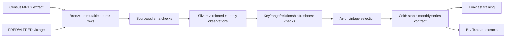

# Versioned data platform

Status: Milestone 2 foundation in progress

## Contract first

RetailPRED uses the same logical table specifications in local tests and the eventual Databricks implementation. Storage engines may differ, but keys, nullability, schema versions, quality gates, and point-in-time semantics may not.

## Tables

### Bronze `mrts_extract_rows`

- Grain: one raw Census response row within a declared extract/release.
- Key: deterministic `source_record_id`, hashed from `extract_id` and canonical raw row content.
- Behavior: append-only immutable facts. Replaying the same extract is a no-op; conflicting content for an existing key stops the pipeline.
- Provenance: source URL, extract ID, release time when known, vintage time, and ingestion time.

### Silver `monthly_observations`

- Grain: one series, observation month, and vintage.
- Key: (`series_id`, `observation_time`, `vintage_time`).
- Values: native-monthly, seasonally adjusted MRTS sales in millions of U.S. dollars.
- Behavior: revisions coexist as new vintages. No update-in-place erases a prior value.

### Economic vintages `fred_extract_rows` → `economic_observations`

- FRED requests declare the same date for `realtime_start` and `realtime_end`, request untransformed monthly values, and record that date as the vintage being reconstructed. The response real-time interval must contain that requested date. See the official [series observations API](https://fred.stlouisfed.org/docs/api/fred/series_observations.html).
- Missing source values (`.`) remain visible in bronze but are not promoted as numeric silver facts.
- Grain and merge behavior mirror MRTS: raw extract rows are immutable, while silver keeps one series/month/vintage value.
- The adapter uses the documented FRED `output_type=1` real-time-period response. It does not treat today's latest values as historically available.

### Gold `monthly_series`

- Grain: one series and observation month at a requested as-of timestamp.
- Key: (`series_id`, `observation_time`).
- Adds governed series name, Census category code, unit, and seasonal-adjustment metadata.
- Consumers: forecasting datasets and BI. Training must not read bronze or bypass silver quality checks.

## Merge and schema policies

- Exact release replays are idempotent.
- Immutable-key conflicts fail rather than choosing an arbitrary winner.
- Unknown, missing, or extra columns fail until a reviewed `schema_version` change updates the shared contract.
- Every local Parquet table has a manifest containing layer, schema version, key, row count, SHA-256, and update time. Reads verify the manifest before returning data.
- Databricks Delta tables will implement the same behavior with declared schemas and `MERGE` keys; automatic unreviewed schema evolution will remain disabled.

## Quality gates

| Gate | Layer | Failure behavior |
|---|---|---|
| Source row shape and required provenance | Bronze | Stop ingestion |
| Schema and nullability | All | Stop read/write |
| Unique immutable key | Bronze/Silver | Stop merge |
| Registered series relationship | Silver | Stop promotion |
| Finite, non-negative retail values | Silver | Stop promotion |
| Freshness against declared as-of threshold | Silver | Stop downstream training |
| Monthly continuity | Gold | Stop snapshot publication |
| Parent/child reconciliation | Hierarchical gold tables | Stop publication outside tolerance |
| Manifest hash and row count | Local storage | Stop read |

## Point-in-time behavior

An as-of query filters out vintages later than the requested timestamp, then selects the latest eligible vintage for every series/month. This reconstructs what the stored platform knew at that time. It does not manufacture historical vintages that were never ingested.

## Local and Databricks parity

The local reference implementation writes Parquet plus integrity manifests under ignored `data/v2/lakehouse/`. Databricks will map bronze, silver, and gold to Delta tables but reuse the logical specifications and fixture-driven contract tests. `scripts/run_local_mrts_pipeline.py` is the local orchestration reference; Databricks Workflows remains the selected production orchestrator unless a real portability requirement changes decision D007.

An SCD2 category dimension is intentionally deferred. The registry currently has no implemented, evidence-backed category-history change requiring SCD2 semantics.
